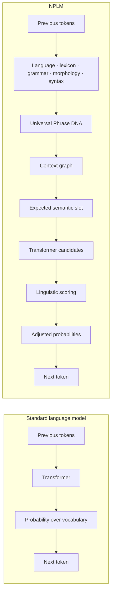
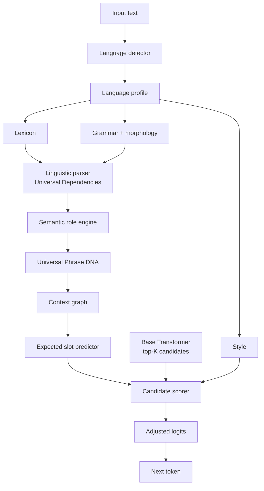
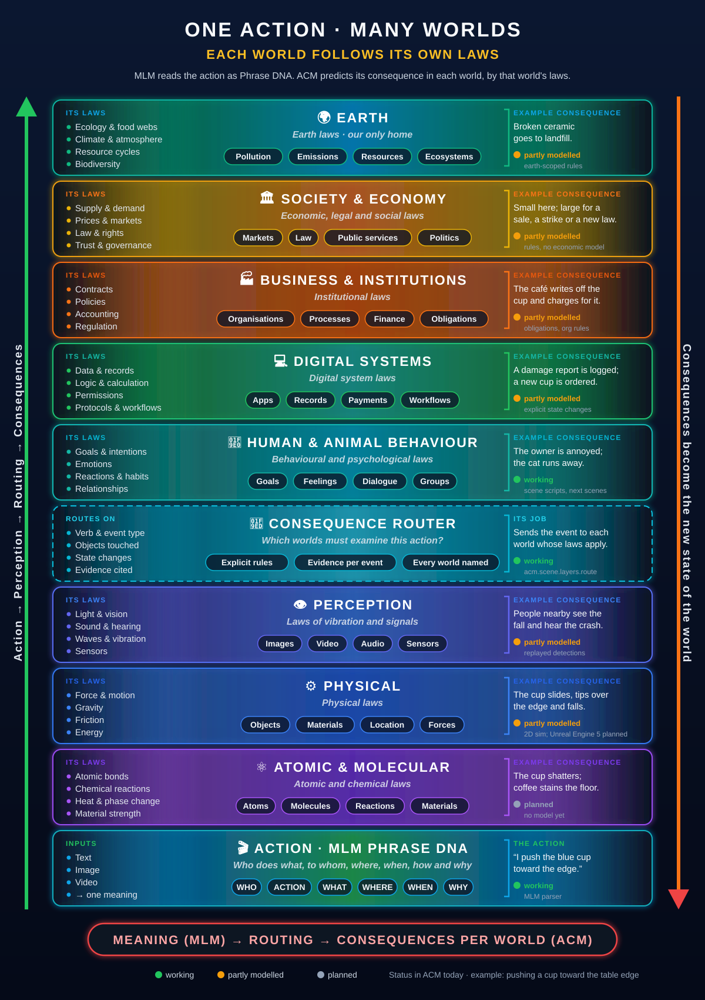
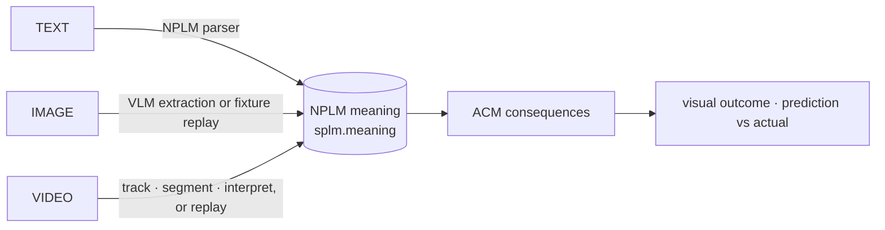
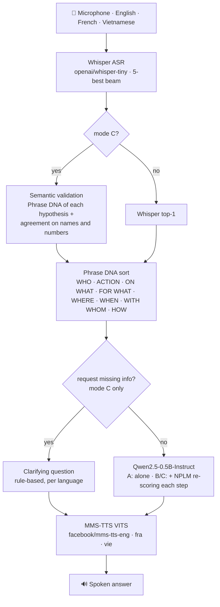

# NPLM · Next Phrase Language Model

**Understand meaning before predicting language.**

> ### 👋 To Y Combinator and investors
>
> **1 · The problem.** A language model predicts the next *token*, often only a fragment of a word, from
> statistics. It has no explicit idea of who does what, to whom, where and why. So it cannot say what kind
> of meaning should come next, and the same event in two languages looks like two unrelated strings.
>
> **2 · Our solution and where it stands.** NPLM turns every sentence into **Universal Phrase DNA**: a
> language-independent frame of who does what, to whom, where, when, how and why. It predicts the next
> *phrase slot* (a place, a time, an action), then re-scores the same LLM's candidates against it. It is
> the meaning layer for our two other models: **[ACM](https://github.com/Sherlock2019/ACM)**, which predicts
> an action's consequences in an AI's digital world, and
> **[ACMP](https://github.com/Sherlock2019/Butterfly-effect-AImodel)**, which predicts them across a
> ten-layer world view.
>
> **New: a Speech Lab.** You talk; Whisper transcribes; NPLM sorts your words into Phrase DNA (WHO ·
> ACTION · ON WHAT · FOR WHAT · WHERE · WHEN · WITH WHOM · HOW) and answers through the same LLM with its
> re-scoring layer; a local Hugging Face voice speaks the answer. Three modes (plain LLM, NPLM, NPLM with
> semantic transcript validation) are benchmarked on identical inputs. See [Speech Lab](#speech-lab-whisper--nplm--tts).
>
> Today it is a working research proof of concept in English, French and Vietnamese, with 175 tests. On a
> 61-item hand-written suite it predicts the expected slot correctly 73.8% of the time (top-1). It never
> ranked a correct answer lower than the base model did. It is **not yet shown** to improve next-word
> prediction on natural text, and it costs about 4× the latency.
>
> **3 · What next.** We need resources and engineers to build a full, new **Action Prediction Model**:
> train it, test it, evaluate it, then improve and retrain it in a loop. NPLM is its front end: it reads an
> action from text, images or video. We also want to collaborate with AI frontier labs and sell the model to
> them. See [My ask for investors](#my-ask-for-investors) and [Build it with us](#build-it-with-us).
>
> *Draft: frontier labs as partners and customers is a hypothesis to validate. Amounts are placeholders.*

**📖 [Full README](#why)** &nbsp;·&nbsp; **⏱️ [30-second version](README-30s.md)**

---

## WHY

### The problem: language models predict the next token, not the next phrase

A token is often only part of a word: `Boston` may be one token, while a rarer name is split into several
pieces. The model chooses one piece at a time from statistics. It never explicitly predicts:

- the **next phrase**: "John will meet Sarah in ___" needs a place or a time, not just a likely next
  fragment;
- the **next action** an actor will take;
- the **next state** of an actor or object: where it is, what condition it is in, and what has changed.

People think in terms of who does what, to whom, where and why. A token model has no explicit idea that
"Sarah" is a participant rather than a location, or that a French sentence and a Vietnamese sentence can
describe the same event.

### LLM prediction vs NPLM prediction: same input, different output

*The LLM column is the base model alone (SmolLM2-135M) or typical behaviour of a token model. The NPLM
column is real output from this repository.*

| Input | LLM prediction | NPLM prediction |
|---|---|---|
| “John will meet Sarah in ___” | A probability over fragments: `the` 38.3%, `a` 5.4%, `her` 3.3%, `his` 2.1%. No idea what kind of word is needed | **Expected slot: location 81.6%**, time 13.8%. `Paris`, `London` and `Boston` gain +2.05 logits; `town` moves up 9 places; the newline is demoted |
| “If John knew that Sarah might leave, he would call her.” | One flat string of tokens | A nested frame: ACTION *call* (conditional), under the condition STATE *know* (John), which contains ACTION *leave* (Sarah, possible, certainty 0.35) |
| The same event in English, French and Vietnamese | Three unrelated token sequences | The same structure: ACTION meet · WHO John · WITH WHOM Sarah · WHERE Paris · future tense. Structural agreement en↔fr 93.3% |
| What is missing from a sentence | Not tracked | Listed: “NOT STATED: WHAT, TO WHOM, WHERE TO, USING WHAT, WHY” |
| Does it really help next-word prediction? | — | Says **“insufficient data”** (11 samples) instead of claiming a win |
| 🎤 Spoken: “Book a meeting with Sarah tomorrow.” (Whisper-tiny → Qwen2.5-0.5B-Instruct → MMS-TTS) | Mode A, Qwen alone: *“Please provide your availability for a meeting with Sarah tomorrow.”* (end to end 4.0 s) | Phrase DNA: ACTION *book* · ON WHAT *meeting with Sarah* · WHEN *tomorrow* · no clock time → mode C asks *“What time would you like to book meeting with Sarah?”* (end to end 1.9 s). Mode B (same Qwen + NPLM): *“Please provide your availability details so I can book an appointment with Sarah tomorrow.”* (5.9 s) |
| 🎤 What did the user actually say? | One transcript string, right or wrong | Whisper's 5-best re-ranked by Phrase DNA; names or numbers the hypotheses disagree on are flagged (e.g. *uncertain entity 'sarah': heard in 2/5 hypotheses*) |

### The hypothesis under test

NPLM tests a narrow hypothesis: **making that structure explicit, and using it to re-weight candidates,
improves prediction enough to justify its cost.**

The project exists to *find out* whether that is true, not to show that it is. So:

- every component can be switched off;
- every comparison uses identical input, model and hardware;
- cost is reported next to benefit;
- and where the evidence does not support an improvement, the tooling says so.

---

## WHAT

### A meaning layer on top of a language model

NPLM is a research proof of concept. Before the language model picks the next token, NPLM asks *what is
happening, who is involved, and what kind of information is missing?* It then scores the **same**
Transformer's top-K candidates against that structure. The token model still writes the words; Phrase DNA
decides what kind of words should come next.

*Names:* the CLI and dashboard call it **MLM** (Meaning Language Model), and the Python package is `splm`.
They are the same project.

**Universal Phrase DNA is the core.** Every sentence becomes a language-independent frame: an actor (WHO)
that is in a STATE or does an ACTION, plus WHAT, TO WHOM, WHERE, WHEN, HOW, USING WHAT, WITH WHOM, WHY and
FOR WHAT GOAL. The frame does not depend on word order or language. Everything else either builds this frame
(parser, semantic roles, morphology) or uses it (context graph, slot predictor, candidate scorer, and the
consequence models). See [Universal Phrase DNA](#universal-phrase-dna).

```
John will meet Sarah in Paris tomorrow.

ACTION: meet     WHO: John     WITH WHOM: Sarah
WHERE:  Paris    WHEN: tomorrow     tense=future
```



On a real prompt:

```
$ python -m splm.cli predict "John will meet Sarah in" --detail

EXPECTED PHRASE SLOT
  location    81.6%      <- a standard model makes no such prediction
  time        13.8%

BASE MODEL                     MLM
----------------------------   ----------------------------
the               38.3%   the               46.3%
a                  5.4%   a                  6.5%
her                3.3%   town               4.7% ^9
his                2.1%   her                3.9% v1
```

`Paris`, `London` and `Boston` each gain **+2.05 logits** because they fit the expected LOCATION slot, and
the newline token is demoted. NPLM did *not* change the top choice here. With a 135M model that is the
honest result, so it is shown rather than hidden.

### Its place in the family: understand → predict consequences → decide

| Model | Question it answers | How it uses NPLM |
|---|---|---|
| **NPLM** (this repository) | What is happening: who does what, to whom, where, when, why? | — |
| **[ACMP](https://github.com/Sherlock2019/Butterfly-effect-AImodel)** · Butterfly Effect Model | What does this action change across ten layers of the world, from Earth & Ecosystems to the Physical World? | Optional: ACMP calls NPLM's `POST /api/analyze` to turn the action into Phrase DNA before routing it |
| **[ACM](https://github.com/Sherlock2019/ACM)** · Action–Consequence Foresight Model | Is this AI agent's plan safe to execute in its digital world, and may it go ahead? | ACM v1 ([`v1` branch](https://github.com/Sherlock2019/ACM/tree/v1), the Python `acm` package) reads NPLM's meaning representation and powers Live mode; see [Multimodal](#multimodal-text-image-video--nplm--acm). ACM's `main` branch does not use NPLM yet |

The same meaning representation also accepts **images and video**, and now **speech**.

### Speech Lab: talk to NPLM

The `/speech` dashboard page (and `scripts/speech_lab_gradio.py`) turns NPLM into a voice pipeline,
with every model running locally from Hugging Face:

```
🎤 microphone ─► Whisper ASR ─► [Phrase DNA validation] ─► Phrase DNA sort ─► LLM │ NPLM ─► MMS-TTS ─► 🔊
               openai/whisper-tiny    (mode C only)        WHO · ACTION …    Qwen2.5-0.5B-Instruct   en · fr · vi
```

After you speak, the main output is **your words sorted into Phrase DNA**:

| WHO | ACTION / STATUS | ON WHAT | FOR WHAT | WHERE | WHEN | WITH WHOM | HOW |
|---|---|---|---|---|---|---|---|
| subject | predicate (action or state) | objects, recipients | goal, cause | location, destination, source | time | participants | manner, instrument |

A `?` marks information the action expects but you did not give; words the parser could not place are
listed as *unsorted* rather than forced into a box. Then the model answers, as text and as speech.

| Mode | Pipeline | What differs |
|---|---|---|
| **A · Base Transformer** | Whisper top-1 → Qwen2.5-0.5B-Instruct → TTS | the reference |
| **B · NPLM** | Whisper top-1 → the *same* Qwen weights + NPLM re-scoring at every decoding step → TTS | only the NPLM layer |
| **C · NPLM + validation** | Whisper 5-best → Phrase DNA checks pick the transcript → NPLM → TTS, plus a clarifying question when a request is missing information | the transcript and the dialogue policy |

NPLM still needs a base Transformer: it replaces the *standalone* LLM in the voice loop with the full NPLM
inference stack, not Transformers altogether.

### What it is not (yet)

- **Not a new foundation model.** It re-scores the candidates of an existing Transformer; it trains no
  weights today, and everything reported is rule-based.
- **Not proven on natural text.** The favourable numbers come from a small hand-written suite.
- **Not a filter.** It re-weights candidates and deletes nothing, so it says "less compatible", never
  "impossible".
- **Not real vision yet.** Image and video inputs are replays of hand-authored extractions on synthetic
  media, labelled as such.
- **Not a production voice assistant.** The Speech Lab is a measurement bench: a 0.5B answer model, a
  rule-based clarification policy, no streaming, and a benchmark on synthetic (TTS-generated) speech.

### Key terms

- **Token:** the piece of text a language model predicts, often part of a word.
- **Phrase DNA:** the language-independent frame of a sentence (WHO, ACTION or STATE, WHAT, WHERE, …).
- **Slot:** one position in that frame; the *expected slot* is the kind of meaning that should come next.
- **Language pack:** the YAML files that hold all linguistic knowledge for one language.
- **Ablation:** switching a layer off to measure what it contributes.
- **ASR / TTS:** automatic speech recognition (speech → text) and text-to-speech.
- **WER / CER:** word / character error rate of a transcript against what was really said.
- **RTF:** real-time factor, processing time ÷ audio duration (below 1 is faster than real time).
- **Time to first audio:** from the end of the user's recording to the first synthesised audio chunk.

---

## SO WHAT: benefits and business value

**Benefits**

- **A prediction a plain model cannot make.** NPLM says what *kind* of meaning comes next (a place, a time,
  an action), not only which fragment.
- **One structure across languages.** English, French and Vietnamese sentences that mean the same thing
  give the same frame.
- **Explainable.** Every adjustment to a candidate comes with the slot and the evidence behind it.
- **Never makes the base model worse on the suite.** 2 wins, 9 ties and 0 losses by rank of the correct
  answer; ablating everything reproduces the base model exactly.
- **Honest by construction.** "No evidence" is never counted as zero, and verdicts come from statistics,
  with *insufficient data* below 20 samples.
- **The input to consequence prediction.** Text, images and video become the actor, action, object and
  state that ACM and ACMP need.
- **Focus, not speed (yet).** Phrase DNA tells the model *which kind* of piece comes next (a place after
  "meet Sarah in") and re-ranks the candidates toward it. It does not skip work: the Transformer still
  reads the whole prompt and scores the whole vocabulary, and NPLM re-parses the growing sentence at each
  step, so today it **costs** about 4× the latency per prediction and saves no tokens. Efficiency gains are
  hypotheses to measure (see [What next](#what-next-evolution-of-the-product)).
- **Voice that knows what is missing.** Spoken requests are sorted into Phrase DNA, so a voice agent can
  ask “What time would you like to meet Sarah?” instead of guessing, and can flag a name or number that the
  speech recogniser was unsure about.

**Business value (target users, to be validated)**

| Who | Use | Value |
|---|---|---|
| AI labs and LLM researchers | an explicit next-phrase signal on top of any base model, with ablations | a measurable, interpretable test of whether structure helps prediction |
| Teams building AI agents | Phrase DNA as the input to consequence and decision models (ACM, ACMP) | agents that know who does what before they predict what it changes |
| Multilingual NLP teams | one frame across languages, added through YAML packs | new languages without engine changes |
| Education and linguistics | parse trees, roles, morphology and frames shown side by side | teaching material for grammar and meaning |
| Voice-assistant builders (call centres, booking, in-car) | spoken request → Phrase DNA → clarify or answer | fewer wrong actions from misheard names, numbers and missing details (to be shown on real recordings) |

### Measured results

From `python scripts/benchmark.py` (SmolLM2-135M, CPU, 61 items of the hand-authored diagnostic suite).
**These are real measurements of a small model on a small suite, not a benchmark of record.**

| Metric | Base | NPLM | Difference | Verdict |
|---|---|---|---|---|
| Expected slot accuracy (top-1) | — | **73.8%** (45/61) | n/a | NPLM-only capability |
| Expected slot accuracy (top-3) | — | **83.6%** (51/61) | n/a | NPLM-only capability |
| Next-word accuracy (top-1) | 63.6% | 72.7% | +9.1 pp | **insufficient data** (n=11) |
| Mean rank of correct answer | 2.55 | 1.82 | −0.73 | — |
| Mean reciprocal rank | 0.739 | 0.809 | +0.070 | — |
| Semantic focus | 32.1% | 44.1% | +12.1 pp | over 25 predictions |
| Latency per prediction (warm) | 75 ms | 306 ms | **+231 ms** | cost |

Per item, by rank of the correct answer: **2 wins, 9 ties, 0 losses**.

Cross-language structural consistency (same meaning, three languages):

| Pair | Agreement |
|---|---|
| English ↔ French | 93.3% |
| English ↔ Vietnamese | 78.3% |
| French ↔ Vietnamese | 71.7% |

Slot accuracy varies by slot, which shows where the rules are weak:

| Strong | | Weak | |
|---|---|---|---|
| WHERE | 100% (10/10) | WHY | 33% (1/3) |
| USING WHAT | 100% (4/4) | WHERE TO | 60% (3/5) |
| HOW | 100% (4/4) | FOR WHAT GOAL | 60% (3/5) |
| TO WHOM | 100% (2/2) | WHEN | 50% (3/6) |

**What this does and doesn't mean:**

- **It works as a mechanism.** NPLM produces a slot prediction a plain model cannot, stays consistent
  across languages, and never ranked a correct answer lower.
- **It is not shown to improve next-word prediction.** Eleven samples with one disagreement can't support
  a verdict, so the tooling returns *insufficient data* despite the favourable point estimate.
- **Slot accuracy has no baseline.** A plain model makes no slot prediction, so it is a capability
  measurement, not a win.
- **The suite was written alongside the rules it tests.** A good score localises failures; it is not
  evidence about natural text.
- **It costs about 4× the latency**, mostly from parsing on CPU.

---

## HOW

### Architecture



| Layer | Answers | Module |
|---|---|---|
| Language detector | Which language? (separately: locale, script) | `splm/language/detector.py` |
| Lexicon | What words exist, what do they mean? | `splm/linguistic/lexicon.py` |
| Morphology | Person, number, tense, gender, case, aspect, mood, polarity | `splm/linguistic/morphology.py` |
| Grammar | Which forms and constructions are valid? | `language_packs/<lang>/grammar.yaml` |
| Syntax | How do words relate structurally? | `splm/linguistic/parser.py` |
| Semantic roles | What part does each entity play? | `splm/linguistic/semantic_roles.py` |
| Phrase DNA | What does the sentence represent? | `splm/phrase/schema.py`, `builder.py` |
| Context graph | What has happened, who is involved? | `splm/graph/context_graph.py` |
| Slot predictor | What kind of meaning comes next? | `splm/phrase/slot_predictor.py` |
| Scorer | Which candidates fit? | `splm/model/candidate_scorer.py` |

Two design rules hold everything together:

1. **No linguistic facts in Python.** Which lemma is a STATE, which adposition means WHERE, which verb
   takes a PARTICIPANT: all of it lives in `language_packs/`. The modules hold algorithms.
2. **No model or weight is hard-coded.** The base model id, every scoring weight and every ablation switch
   come from `config/`.

### Universal Phrase DNA

Every sentence becomes a language-independent frame:

```
WHO
├── IS IN WHAT STATE?
└── DOES WHAT?
      ├── WHAT / TO WHOM?   WHERE?   WHEN?   HOW?
      ├── USING WHAT?       WITH WHOM?
      └── WHY?  FOR WHAT GOAL?  UNDER WHAT CONDITIONS?
```

**It is recursive**, so complex language is not flattened:

```
$ python -m splm.cli parse "If John knew that Sarah might leave, he would call her."

ACTION: call            modality=conditional
WHO:  he      WHAT: her
UNDER WHAT CONDITIONS:
  └── STATE: know
      WHO: John
      WHAT: Sarah might leave
        └── ACTION: leave
            WHO: Sarah      modality=possible  certainty=0.35
```

**It stores no word order.** English, French and Vietnamese express the future differently and order
words differently, yet arrive at the same structure:

| | English | French | Vietnamese |
|---|---|---|---|
| surface | John will meet Sarah in Paris tomorrow. | John rencontrera Sarah à Paris demain. | Ngày mai John sẽ gặp Sarah ở Paris. |
| predicate | ACTION meet | ACTION rencontrer | ACTION gặp |
| WHO | John | John | John |
| WITH WHOM | Sarah | Sarah | Sarah |
| WHERE | Paris | Paris | Paris |
| tense | future *(auxiliary)* | future *(inflection)* | future *(particle)* |

The locative reading is shared too: `John is in Paris` / `John est à Paris` / `John đang ở Paris` all give
`STATE` with sense `located`.

### Language packs

Adding a language means adding a directory, not changing the engine.

```
language_packs/
├── universal/
│   ├── phrase_schema.yaml       slots, predicate types, grammatical categories
│   ├── semantic_roles.yaml      the role inventory and how roles map to slots
│   └── dependency_mapping.yaml  UD relation -> role priors (probabilities)
├── en/ fr/ vi/
    ├── grammar.yaml      predicate types, auxiliaries, negation, agreement
    ├── syntax.yaml       adposition and subordinator cues, per-verb argument structure
    ├── morphology.yaml   feature normalisation, pronouns, inflection
    ├── semantics.yaml    slot compatibility evidence and gazetteers
    ├── styles.yaml       register markers
    └── idioms.yaml       multi-word expressions
```

The packs encode real linguistic difference, not translated English:

- **French:** `à` is four-way ambiguous (place, time, recipient, destination); negation is two-part
  (`ne … pas`); gender agreement is checkable.
- **Vietnamese:** no inflection at all. Tense comes from preverbal particles (`đã`, `đang`, `sẽ`),
  adjectives are predicates without a copula, `ở` is both a locative verb and a preposition, and pronouns
  encode social relationship.

YAML is loaded strictly and **refuses duplicate keys**, because a repeated key in a per-verb table would
silently drop an entry.

### Honesty rules, enforced in code

- **No evidence contributes exactly zero.** Every score carries an `informative` flag and is centred on a
  neutral value; the dashboard prints "no evidence", not 0.50.
- **Re-ranking is not filtering.** NPLM re-scores the top-K and deletes nothing. A candidate NPLM dislikes
  can still win if the base model is confident enough.
- **Coverage is always reported.** Metrics say how many candidates the seed gazetteers could judge, and
  "no evidence" is never counted as "incompatible".
- **Verdicts come from statistics.** Four outcomes (*MLM improved*, *no meaningful difference*, *base model
  better*, *insufficient data*) from a Wilson interval and an exact McNemar test. Below 20 samples, no
  verdict is given.
- **Ablating everything reproduces the base model exactly**, asserted in `tests/test_candidate_scorer.py`.
- **Latency is measured warm** (`engine.warmup()` first); cold results are flagged `warm: false`.
- **Perplexity is base-model only**, because NPLM's top-K scores are not a normalised distribution.

### Command line

```bash
python -m splm.cli parse    "John will meet Sarah in Paris tomorrow by train to discuss the contract." --tree
python -m splm.cli slots    "John will meet Sarah in"      # expected next slot
python -m splm.cli predict  "John will meet Sarah in" --detail
python -m splm.cli generate "John will meet Sarah in"      # base vs NPLM, same settings
python -m splm.cli detect   "Ngày mai John sẽ gặp Sarah ở Paris."
python -m splm.cli languages
python -m splm.cli config model.model.model_id
```

`--profile tiny|small|medium|research` picks a base model from `config/model.yaml`;
`--ablation base_only|phrase_only|everything|…` switches layers off.

Example `parse --tree` output:

```
ACTION:            WHERE:              FOR WHAT GOAL:
  meet               Paris               discuss the contract
WHO:               WHEN:                 ACTION: discuss
  John               tomorrow            WHAT:   contract
WITH WHOM:         HOW:
  Sarah              train {transport=train}

GRAMMAR: tense=future  modality=intention  voice=active  certainty=0.90
NOT STATED: WHAT, TO WHOM, WHERE TO, USING WHAT, WHY
```

### Test and benchmark

```bash
pytest                                       # 175 tests, no model downloads needed
pytest -m llm tests/test_speech.py           # opt-in: real Whisper -> Qwen -> TTS round trip
python scripts/demo.py --stage all           # walk the whole pipeline
python scripts/benchmark.py                  # writes results/*.json and *.csv
python scripts/benchmark.py --ablation-ladder
```

Tests run against committed CoNLL-U fixtures, so they are fast, deterministic and need no parser.
Regenerate them with `python scripts/make_fixtures.py` and review the diff; a change there changes the
tests' premises.

### Predicting consequences: 1 actor, 1 action = consequences in cascade

Phrase DNA says *who does what*. The next question is *what does that action change?* An action by an
actor (a person, an animal, an object, a system) does not happen in one world. The same event is felt in
several worlds at once, and **each world follows its own laws**. The AI predicts the consequence of the
action separately in each world, using that world's laws, and then shows how far each consequence reaches.
[ACMP](https://github.com/Sherlock2019/Butterfly-effect-AImodel) now carries this idea to a ten-layer world
view.

<p align="center">
  
</p>

The same stack as a table, for "I push the blue cup toward the edge of the table":

| World | Its laws | Example consequence | Status in ACM v1 |
|---|---|---|---|
| ⚛️ Atomic and molecular | Atomic and chemical laws: bonds, reactions, heat | the cup breaks into pieces; coffee stains the floor | planned, no model yet |
| ⚙️ Physical | Physical laws: force, motion, gravity, friction, energy | the cup slides, tips over the edge and falls | partly: positions, holders, owners and a 2D tabletop simulator; 3D physics planned |
| 👁️ Perception | Laws of vibration and signals: light, sound, sensing | people nearby see the fall and hear the crash | partly: who sees or hears each event; image/video detection replayed |
| 🧠 Human and animal behaviour | Behavioural and psychological laws: goals, emotions, reactions, relationships | the owner is annoyed; the cat runs away | working: scene scripts and next-scene prediction |
| 💻 Digital systems | System laws: records, permissions, calculations, workflows | a damage report is logged; an order for a new cup is placed | partly: explicit state changes and amounts |
| 🏭 Business and institutions | Organisational rules, contracts, policies, finance | the café writes off the cup and charges for it | partly: obligations and organisation impact rules |
| 🏛️ Society and economy | Economic, legal and social laws: markets, prices, law, trust | (small here; large for actions such as a sale or a law) | partly: society and country impact rules; no economic model |
| 🌍 Earth | Planetary and ecological laws: resources, pollution, biodiversity | broken ceramic goes to landfill | partly: earth-scoped impact rules; no ecosystem model |

Two axes describe every consequence: the **world** says *which laws* govern it, and the **reach** says
*how far* it goes, from the actor to other actors, the neighbourhood, the organisation, the city, the
country and the earth.

**Consequences cross worlds.** A consequence in one world has consequences in the other worlds, in two
ways:

- **By proximity (⇅).** It ripples into neighbouring worlds and nearby actors. The cup falls (physical),
  people hear the crash (perception), the owner is annoyed (behaviour), a damage report is logged
  (digital), and the café writes off the cup (business).
- **By synchronicity (∿).** Worlds change together, at the same moment, down to the quantum level, so a
  change in one world is matched by a change in another even when no visible chain of cause links them.

At the quantum level, changing together is correlation, not a signal: entangled systems stay correlated
but cannot carry cause and effect between them. So a synchronous link would mark two consequences as
*correlated*, never as one *causing* the other. This is a concept, not yet modelled.

NPLM's role is the input to this: it turns text, images and video into the actor, action, object and state
that each world's laws need. The consequence prediction itself lives in ACM and ACMP. The table's last
column is the honest status: several worlds have explicit rules only, the atomic world has no model yet,
and none of the world models has been validated for accuracy.

### Multimodal: text, image, video → NPLM → ACM

One scene: *"A blue cup is near the right edge of a table. A red cup is farther from the edge. I plan to
push the blue cup toward the right edge."* It also exists as an image and a short video. NPLM turns all
three into **one shared meaning representation**, and ACM reads it to predict consequences.



`splm.meaning` extends Phrase DNA compatibly:

- **Entities** have stable ids (`blue_cup_01`, `red_cup_01`); two cups are never merged by class.
  Observations carry evidence and an `observed` / `inferred` status.
- **Time.** Scene states form a timeline; proposed actions, predicted outcomes and goals are kept apart
  from events.
- **Coordinates** carry their frame and unit. Pixels are never metres without a calibration.
- **Into ACM**, events become `UniversalPhraseFrame`s directly (`splm.meaning.frames`).
- **Adapters.** Text uses the parser. Image rejects claims a still can't support (a past push, an intent).
  Video keeps event order, marks unseen causes *uncertain*, and `available_at(T)` cuts the timeline so
  later frames can't leak into a prediction.
- **Live backends** (a Qwen3-VL client for any OpenAI-compatible endpoint, an Ultralytics YOLO tracker)
  are optional, lazily loaded, and never download anything.

**Dashboard pages**

- **`/multimodal`**: Text, Image and Video tabs. The video stops at T = 2.0 s, before the push;
  **Predict Consequences** uses only frames up to T, then **Reveal Scripted Outcome** compares prediction
  with what happened. Each run shows input, NPLM meaning, ACM's six circles of consequence, an
  *illustrative simulation*, and three alternatives.
- **`/acm`, `/acm/tour`, `/acm/inference`**: the ACM demo, a four-chapter tour, and 280+ "what happens next
  to …?" questions with reasoning. Started from ACM's `./start.sh`, the dashboard runs in **ACM mode**
  (`NEXT_PUBLIC_APP_MODE=acm`): ACM branding, `/` opens `/acm`, and the MLM Playground moves to `/mlm`.

**Demo mode** needs no keys, GPU or downloads. It replays bundled fixtures through results computed by the
real NPLM + ACM pipeline, and a permanent badge says so. Uploads are previewed, never described as
analysed. **Live** mode turns on per tab only when `/api/multimodal/status` reports it working; today that
is text, with ACM and Stanza installed.

> **Live mode needs ACM v1.** It imports the Python `acm` package (`acm.engine`, `acm.multimodal`, …),
> which lives on the **[`v1` branch](https://github.com/Sherlock2019/ACM/tree/v1)** of the ACM repository.
> ACM's `main` branch is the newer decision-gate app (FastAPI + React) and has no `acm` package. Clone v1
> next to this repo and install it into NPLM's environment:
>
> ```bash
> git clone -b v1 git@github.com:Sherlock2019/ACM.git ../ACM
> pip install -e ../ACM          # inside NPLM's .venv
> ```
>
> `scripts/ec2_service.sh` does the install itself when it finds v1 at `../ACM` (or `SPLM_ACM_DIR`), and
> says so when it finds the main branch instead. Demo mode needs none of this.

Demo materials in `web/public/demo/` come from `python scripts/make_tabletop_demo.py`; the results bundle
from ACM v1's `python -m acm.cli demo --json web/public/demo/demo_results.json`.
`node web/scripts/check-tabletop.mts` checks the browser simulator against the Python one. The dev server
serves only trusted origins (`127.0.0.1`, `localhost`, `SPLM_ALLOWED_DEV_ORIGINS`); otherwise a page
opened by IP stays on "Loading…".

### Speech Lab: Whisper → NPLM → TTS



**Where things are defined**

| What | Where |
|---|---|
| Model ids, beams, voices, decoding, validation weights, dialogue policy | `config/speech.yaml` (env: `SPLM_ASR_MODEL_ID`, `SPLM_SPEECH_DEVICE`) |
| Pipeline and the three modes | `src/splm/speech/pipeline.py` (reuses `SPLMEngine`: parser, scorer, lexicon, config) |
| Whisper n-best beam search (KV-cached) | `src/splm/speech/asr.py` |
| Voices, sentence-chunked synthesis | `src/splm/speech/tts.py` |
| Phrase DNA sort and clarifying questions | `src/splm/speech/dna.py` |
| Semantic transcript validation | `src/splm/speech/validation.py` |
| WER, CER, entity/number preservation, memory | `src/splm/speech/metrics.py` |
| Paired benchmark and built-in utterances | `src/splm/speech/benchmark.py`, `eval_utterances.json` |
| Model provenance (licence, revision, verified) | `src/splm/speech/provenance.py`, `data/speech/verified.json` |
| API | `src/splm/api/speech.py`: `GET /api/speech/status`, `POST /api/speech/turn`, `GET /api/speech/benchmark/results` |
| Dashboard / Gradio | `web/src/app/speech/page.tsx` · `scripts/speech_lab_gradio.py` |

**How the comparison stays fair.** One Whisper beam search per utterance serves all modes (each is charged
its latency); mode C only *reads* more of that beam. Generation is greedy with the same settings in every
mode, and modes A and B load the same Qwen weights once, so for a given transcript the only difference
between their answers is the NPLM layer. TTS is seeded, so the same text gives the same audio. NPLM gets an
opt-in `analysis_prefix` so it parses the growing *answer*, not Qwen's chat template; the default
behaviour of the engine is unchanged.

**Semantic validation (mode C).** Each Whisper hypothesis is sorted into Phrase DNA and scored on
Whisper's own log-probability, whether it has a predicate, how many DNA boxes it fills, missing core
arguments, and how many hypotheses agree on its names and numbers. A hypothesis may replace Whisper's top-1
only within 1.5 log-probability units of it, so validation re-ranks near-ties and never overrides clearly
heard audio. Names or numbers heard by fewer than half of the hypotheses are flagged.

**Dialogue policy (mode C).** For an imperative with an action predicate, if the Phrase DNA lacks something
the request needs (a clock time for *book / meet / call / schedule*, or an expected object, place or
partner), the assistant asks for it, in the user's language, instead of generating an answer.

**Run and benchmark**

```bash
python scripts/download_resources.py --speech          # fetch + run each model, write data/speech/verified.json
python scripts/speech_benchmark.py                     # 48 built-in utterances (en 24, fr 12, vi 12), all modes
python scripts/speech_benchmark.py --manifest data/speech/manifest.jsonl   # your own recordings
python scripts/speech_lab_gradio.py                    # optional Gradio UI (pip install -e '.[ui]')
```

**Measured results: not yet.** The paired benchmark has not been run on the full set, so **no improvement
is claimed** for any mode. What has been measured is single utterances on CPU (WSL, 12 threads, no GPU):

| One utterance, “Book a meeting with Sarah tomorrow.” (TTS audio) | A · Base | B · NPLM | C · NPLM + validation |
|---|---|---|---|
| End to end | 4.0 s | 5.9 s | 1.9 s (clarifying question, no generation) |
| Whisper-tiny 5-best (KV-cached) | ~0.5–0.8 s for ~3 s of audio (RTF ≈ 0.2–0.3) | same | same + ~0.5 s validation |
| TTS for a one-sentence answer | ~0.5–1.0 s (RTF ≈ 0.2) | same | same |
| Process memory, all models loaded | ~4.5–4.9 GB peak RSS | same process | same process |

Model verification (`download_resources.py --speech`): each voice spoke a test sentence and Whisper-tiny
heard it back at CER 0.00 (en), 0.12 (fr), 0.26 (vi). Run `python scripts/speech_benchmark.py` for WER,
CER, slot accuracy, entity and number preservation, latencies, RTF and memory over 48 paired items, with
statistical verdicts (below 20 paired items the tooling answers *insufficient data*).

**Speech Lab limitations**

- **The benchmark audio is synthetic.** It is the MMS-TTS voice read back by Whisper, not people. Real
  accents, noise and disfluencies are untested; supply recordings with `--manifest` before any claim about
  users.
- **Answer quality is not scored.** There are no reference answers; only latency and transcript-side
  metrics are measured. A 0.5B model often answers vaguely (“I'm sorry, I can't assist with that”).
- **Slot accuracy compares against the parser's own reading of the reference**, unless the manifest gives
  gold slots, so it measures transcript damage to meaning, not parser correctness.
- **No streaming.** Audio comes back in one piece; *time to first audio* is the server-side time to the
  first synthesised sentence.
- **Microphone needs HTTPS or localhost** (a browser rule). Over plain `http://IP` use the SSH tunnel below,
  Upload, or typed text.
- **MMS-TTS voices are CC-BY-NC 4.0 (non-commercial)**. Swap them in `config/speech.yaml` before
  commercial use. Whisper is MIT, Qwen2.5-0.5B-Instruct Apache-2.0.
- **The clarification policy is a handful of rules**, a demonstration of Phrase-DNA-driven dialogue, not a
  dialogue manager. Vietnamese Phrase DNA inherits the parser's weaknesses (see Limitations).

### Deploy on AWS EC2

The installer runs the Next.js build and the Python API as `systemd` services that survive logout and
reboot. The dashboard listens publicly; the API stays on `127.0.0.1` behind the dashboard's `/api` proxy.

Prerequisites: Ubuntu with a public IPv4, `systemd`, Git, Python 3.11+, Node 20.9+, npm, `curl`.

```bash
./scripts/ec2_service.sh install                     # first install, downloads models
./scripts/ec2_service.sh status | logs | restart

git pull --ff-only                                   # later revisions
SPLM_SKIP_RESOURCES=1 ./scripts/ec2_service.sh deploy
```

- Open inbound **Custom TCP 3010** in the security group (source **My IP** for private use). Keep `8001`
  closed. Browse to `http://EC2-PUBLIC-IP:3010`.
- The endpoint is **plain HTTP with no authentication**. Put it behind HTTPS and auth before exposing it
  widely.
- `SPLM_TORCH_MODE=cuda` for GPU instances; `SPLM_WEB_PORT` for another port; an Elastic IP if the address
  must survive stop/start.
- **Speech Lab on EC2.** `install` also installs `ffmpeg`, downloads and verifies Whisper, the three MMS-TTS
  voices and Qwen2.5-0.5B-Instruct (`SPLM_SKIP_SPEECH=1` skips), and warms them at API start
  (`SPLM_SPEECH_WARMUP=0` to load on first use). Budget **≥ 8 GB RAM** (t3.large or larger): the process
  holds about 4–5 GB with every model loaded. Browsers only open the microphone on HTTPS or localhost, so
  either tunnel and open `http://localhost:3010/speech`:

  ```bash
  ssh -L 3010:localhost:3010 ubuntu@EC2-PUBLIC-IP
  ```

  or put HTTPS (Caddy, nginx + Let's Encrypt, or an ALB) in front of port 3010.

### Extend

**Add a language**

1. Create `language_packs/<code>/` with the six YAML files (copy `en/`).
2. Add the code to `app.languages.supported` and `app.parser.processors` in `config/app.yaml`.
3. `python scripts/download_resources.py --languages <code>`
4. `python scripts/make_fixtures.py --languages <code>`, then add cases to `tests/test_multilingual.py`.

No engine change. `test_packs_declare_the_same_interface` checks every pack fills the same slots.

**Add a linguistic feature**

1. Add the score to `CandidateFeatures` and `FEATURE_ORDER` (`splm/model/candidate_features.py`); the
   order is positional for trained models.
2. Write a `_score_<feature>` method that sets `informative[...]` honestly.
3. Add a weight in `config/scoring.yaml` and an ablation switch in `FEATURE_SWITCHES`.
4. Test that it contributes zero when it has no evidence.

**Use a different base model**

```bash
SPLM_MODEL_ID=Qwen/Qwen3-4B-Base python -m splm.cli predict "..."
python -m splm.cli --profile research predict "..."
```

**Swap a heuristic for a trained model.** Set `app.slot_predictor.backend: neural` or
`scoring.backend: neural`. Without a checkpoint each falls back to the rule-based version and says so, so
the heuristic is always the baseline to beat.

### Limitations

- **Parser errors propagate silently.** A wrong tree gives a wrong frame. Vietnamese suffers most: the VTB
  parser attaches `John` under the time expression in *Ngày mai John sẽ gặp…*, leaving no WHO, which is why
  en↔vi agreement is 78%.
- **Per-verb argument structure is hand-written** for a few dozen verbs per language.
- **Cross-language comparison is structural only**; comparing content lemmas needs a cross-lingual concept
  inventory.
- **No hard grammatical rules.** The scorer only re-weights, so the UI says "less compatible", never
  "impossible".
- **No lexicon is committed.** First use of a language may start a large Wiktionary build. Disable
  `app.lexicon.auto_download` to stay offline.
- **Multimodal is unexercised on real vision.** Bundled image and video extractions are hand-authored
  replays on synthetic media, labelled as such; the Qwen3-VL and YOLO clients have not been run. The
  tabletop simulator is narrow (rigid discs, one table), and its single scripted episode validates the
  workflow, not accuracy.

### How it was built

- **Backend:** Python 3.11+, FastAPI, Stanza (Universal Dependencies parsing), Hugging Face Transformers
  with CPU-only PyTorch by default.
- **Dashboard:** Next.js, with hand-drawn SVG graphs.
- **Speech:** Whisper and MMS-TTS through Transformers; a hand-written KV-cached beam search for Whisper's
  n-best (in the transformers version tested, `num_return_sequences` returned duplicate beams and ran ~6×
  slower); ffmpeg for browser audio; WAV and WER/CER with the standard library, so no new Python
  dependencies.
- **Deviation from the original spec:** the debugging UI is Next.js rather than Gradio, and graphs are
  hand-drawn SVG rather than React Flow, for fewer dependencies and full layout control. Every requested
  panel is present.

### Business scale-up plan

> Draft: the stages and models below are hypotheses to test, not commitments or results.

1. **Research validation (now).** Run the Universal Dependencies evaluation on natural text at a sample
   size that permits a verdict, and publish the result, whatever it is.
2. **Trained models.** Train the slot predictor and the candidate scorer on that data; measure them against
   the rule-based baseline and on larger base models.
3. **Meaning layer as a service.** Offer Phrase DNA through an API as the input to consequence and decision
   models (ACM, ACMP) and to other teams building AI agents.
4. **Scale.** Language packs built with linguists, then licences and research partnerships with AI labs.
   Revenue models to test: API usage, enterprise licence, research partnerships.

---

## WHAT NOW

### Quickstart

**Requirements:** Python 3.11+ and, for the dashboard, Node 20.9+, on Linux, macOS or WSL.

```bash
git clone git@github.com:Sherlock2019/NPLM-Next-Phrase-language-model-.git
cd NPLM-Next-Phrase-language-model-
./start.sh            # also: ./start.sh status | logs | stop
```

Dashboard <http://127.0.0.1:3010>, API <http://127.0.0.1:8001>, API docs <http://127.0.0.1:8001/docs>. If a
port is taken, the next free one is used and printed. Set `SPLM_NO_OPEN=1` to skip opening a browser.

**Full install**, including the parser models and base Transformer needed for the first prediction:

```bash
python -m venv .venv
source .venv/bin/activate          # Windows: .venv\Scripts\activate
scripts/install_runtime.sh          # CPU-only PyTorch + runtime packages
pip install -e ".[data,dev]"        # optional: development and data tooling

python scripts/download_resources.py --model        # parser models + base Transformer
python scripts/download_resources.py --verify-only  # check each language loads

cd web && npm install && cd ..
scripts/dev.sh start                # API on :8001, dashboard on :3010
scripts/smoke.sh                    # check every page and endpoint answers
```

Notes:

- **Provenance.** Every download (source, version, licence, date, language) is recorded in
  `data/MANIFEST.json`.
- **GPU.** The runtime installer defaults to CPU-only PyTorch to avoid CUDA packages. On a GPU machine use
  `SPLM_TORCH_MODE=cuda scripts/install_runtime.sh`, with `SPLM_TORCH_INDEX_URL` set for your CUDA version.
  CUDA is confirmed by running a kernel; an unsupported GPU falls back to CPU with a warning.
- **Lexicons.** Wiktionary dumps are large. Build them with
  `python scripts/build_lexicon.py --languages en fr vi`, or set `SPLM_LEXICON_AUTO_DOWNLOAD=true` to fetch
  on first use.

**Try these three:**

1. `python -m splm.cli predict "John will meet Sarah in" --detail`: see the expected slot and how the
   candidates move.
2. `python -m splm.cli parse "If John knew that Sarah might leave, he would call her."`: see a nested
   frame.
3. Open **`/multimodal`** in the dashboard: predict what happens to the blue cup from text, image or video,
   then reveal the scripted outcome.
4. Open **`/speech`**, click **Click to talk**, say *“Book a meeting with Sarah tomorrow”*, click again.
   See your words sorted into Phrase DNA, then hear the answer. Try **Compare A · B · C**, and switch the
   language to Français or Tiếng Việt. (`./start.sh` downloads and verifies the speech models on first run;
   needs `ffmpeg`.)

### My ask for investors

> To fill in: the amounts and terms below are placeholders, not figures.

- **Raising:** `[amount]` for `[period]` to take NPLM from a research proof of concept to a trained,
  evaluated Action Prediction Model.
- **Use of funds** (draft split, to confirm):
  - compute and data for training and evaluating the slot predictor and scorer;
  - the Universal Dependencies evaluation and larger base models;
  - ML engineers and computational linguists;
  - real vision for the multimodal input;
  - pilots with AI labs and agent builders.
- **Beyond capital:**
  - introductions to AI frontier labs and research teams;
  - linguists to review and extend language packs;
  - advisors on research partnerships and go-to-market for AI infrastructure.

---

## WHAT NEXT: evolution of the product

The project's value depends on knowing what it has not shown. **The open question:** does NPLM improve
next-word prediction on natural text? Not yet known. The favourable numbers come from a small hand-authored
suite at sample sizes too small for a verdict. **An evaluation on Universal Dependencies is the missing
piece**, and the importer for it is not written yet.

1. **Now → next release**
   - **UD evaluation.** Implement the Universal Dependencies importer and run the benchmark on natural text
     at a sample size that permits a verdict.
   - **Replace seed gazetteers.** Slot compatibility rests on a few hundred hand-listed words. Wikidata
     place types, WordNet hypernyms or Wiktionary categories would widen coverage more than any other
     change.
   - **Cut latency.** About 4× the base forward pass, dominated by CPU parsing.
   - **Efficiency hypotheses to measure.** (1) Ask instead of generating when information is missing: on
     one spoken request the clarifying question took 1.9 s end to end vs 4.0 s for the plain LLM answer,
     with no generated tokens. (2) Send compact Phrase DNA / the context graph instead of the full
     conversation, for fewer prompt tokens (`/api/context` already counts both; the graph is not yet fed
     to generation). (3) Let the predicted slot make a smaller base model good enough. (4) Parse less
     often during generation (`reanalyse_every`).
   - **Speech Lab on real voices.** Evaluate the three modes on real recordings (e.g. FLEURS / Common
     Voice subsets in en, fr, vi) at a size that permits verdicts; stream TTS sentence by sentence.
2. **Next**
   - **Speech: dialogue memory.** Feed each turn's Phrase DNA into the context graph so a follow-up (“at
     three”) completes the earlier request; a learned clarification policy instead of rules.
   - **Train the scorer and slot predictor.** Both neural backends are wired in, but no checkpoint exists;
     everything reported today is rule-based.
   - **UniMorph and PropBank importers**, for morphology and predicate-specific roles.
   - **Real vision.** Run the Qwen3-VL and YOLO clients on real images and video.
   - **Connect ACM's main branch** to NPLM through the Phrase DNA API, as ACMP already does.
3. **Later**
   - **Deeper integration (Phase 10).** Feed role and phrase embeddings into the Transformer, deliberately
     deferred until the external architecture proves itself.
   - **The front end of a full Action Prediction Model:** NPLM understands the action, ACMP predicts its
     consequences across every layer, and ACM decides whether to act.

### Build it with us

Built today: Universal Phrase DNA in three languages, the slot predictor and candidate scorer (rule-based),
honest statistics with ablations, a multimodal meaning representation, a local speech pipeline, and an
19-page dashboard. Everything
not built yet is labelled.

To finish it, we need **top AI talent**: ML engineers for training and evaluation, computational linguists,
multimodal, vision and speech engineers, and inference optimisation.

**Let's work together:**
- Profile and projects: **[dzoannguyentran.jobsmatchnow.com](https://dzoannguyentran.jobsmatchnow.com/#projects)**
- WhatsApp: **[+84 908 618 075](https://wa.me/84908618075)**

---

## Reference

### Data sources and licences

NPLM commits **no** third-party linguistic data. Resources are fetched on request and recorded in
`data/MANIFEST.json` (`python scripts/download_resources.py --list` shows the configured set). Until a
lexicon is available, lexical features report *no evidence* rather than guessing.

| Resource | Used for | Licence | Fetched by |
|---|---|---|---|
| Stanza UD models | Parsing | Apache-2.0 | `download_resources.py` |
| Universal Dependencies 2.14 | Evaluation, slot-predictor training | per-treebank (mixed) | configured; importer pending |
| UniMorph 4.0 | Morphology | CC BY-SA 3.0 | configured; importer pending |
| Wiktionary (wiktextract) | Lexicon | CC BY-SA 4.0 / GFDL | `build_lexicon.py` |
| PropBank 3.4 | Predicate-specific roles | CC BY-SA 4.0 | configured; importer pending |
| openai/whisper-tiny | Speech recognition | MIT | `download_resources.py --speech` |
| facebook/mms-tts-eng · -fra · -vie | Speech synthesis | CC-BY-NC 4.0 (non-commercial) | `download_resources.py --speech` |
| Qwen/Qwen2.5-0.5B-Instruct | Speech Lab answers | Apache-2.0 | `download_resources.py --speech` |

### Project layout

```
config/            model, scoring weights, ablations, data sources  (nothing hard-coded)
language_packs/    all linguistic knowledge, as YAML
src/splm/
  language/        detection, locale, pack loading
  linguistic/      parser interface + Stanza backend, CoNLL-U, lexicon, morphology, roles
  phrase/          Phrase DNA schema, builder, slot predictor, serialisation
  meaning/         shared multimodal meaning: schemas, geometry, frames, adapters
                   (text, image, video, optional Qwen3-VL / YOLO), bundled demo fixtures
  graph/           context graph and coreference
  model/           base LLM, word/token tracking, features, scorer, logits processor,
                   advantage metrics, engine
  style/           register detection
  evaluation/      datasets, metrics with real statistics, baseline arm, benchmark runner
  speech/          Speech Lab: Whisper ASR, MMS-TTS, Phrase DNA sort, validation, pipeline, benchmark
  api/             FastAPI service (speech.py: /api/speech/*)
  cli.py           command line
web/               Next.js dashboard (19 pages, incl. /what-it-is, /speech, the ACM pages, /multimodal, /mlm); demo materials in web/public/demo
scripts/           download_resources, make_fixtures, make_tabletop_demo, demo, benchmark, speech_benchmark,
                   speech_lab_gradio, dev, smoke
tests/             175 tests over committed CoNLL-U and meaning fixtures (speech models faked; one opt-in real run)
results/           benchmark output (JSON + CSV); results/speech/ for the Speech Lab
```

### Licence

Copyright © 2026 Dzoan Nguyen Tran (dzoanNguyentran@gmail.com). The code is released under the
[MIT licence](LICENSE). Downloaded resources keep their own licences, recorded per dataset in
`data/MANIFEST.json`.

---

**Made with love by [DzoanNguyentran@gmail.com](mailto:DzoanNguyentran@gmail.com) · A better World Builder**
