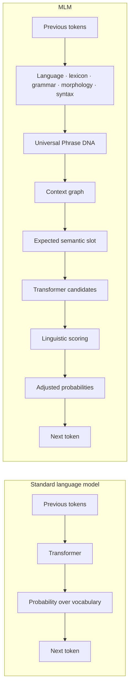
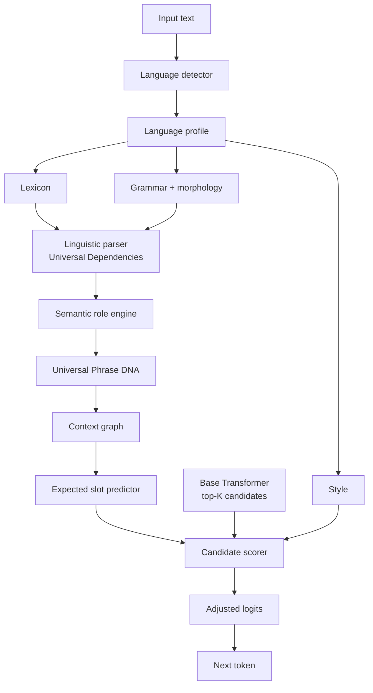
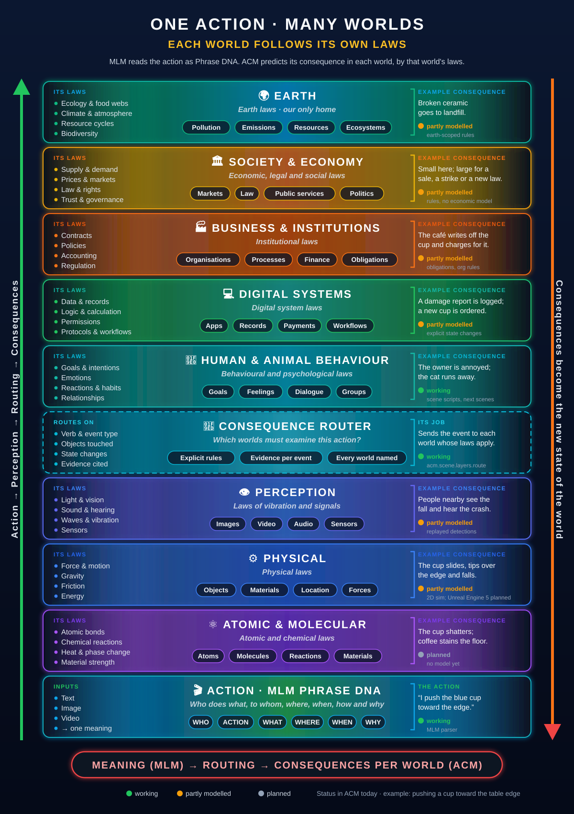
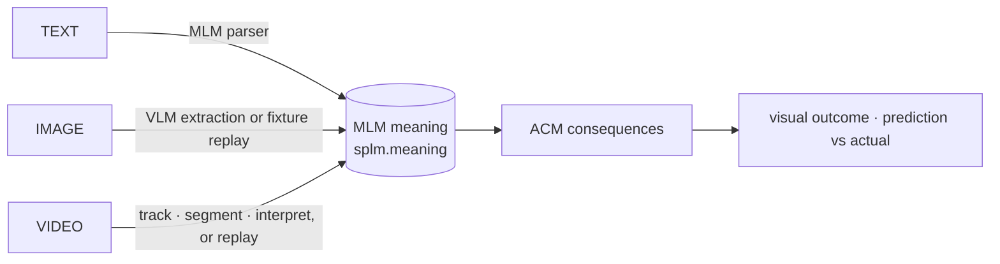

# Meaning Language Model (MLM)

**Understand meaning before predicting language.**

| | |
|---|---|
| [**What**](#what) | A layer that parses meaning and re-scores a Transformer's next-token candidates against it |
| [**Why**](#why) | Next-token statistics don't know *who*, *where* or *what kind of thing* comes next |
| [**So what**](#so-what) | Measured on the same model and hardware: what it buys, what it costs, what isn't proven |
| [**How**](#how) | Architecture, Phrase DNA, consequences across worlds and their laws, install, run, extend |
| [**What next**](#what-next) | Limitations and the work that would settle the open question |

---

## What

MLM is a research proof of concept. Before the language model picks the next token,
MLM asks *what is happening, who is involved, and what kind of information is
missing?* It then scores the **same** Transformer's top-K candidates against that
structure.

**Universal Phrase DNA is the core of MLM.** Every sentence becomes a
language-independent frame: an actor (WHO) that is in a STATE or does an ACTION, plus
WHAT, TO WHOM, WHERE, WHEN, HOW, USING WHAT, WITH WHOM, WHY and FOR WHAT GOAL. The
frame does not depend on word order or language. Everything else in MLM either builds
this frame (parser, semantic roles, morphology) or uses it (context graph, slot
predictor, candidate scorer, ACM). See [Universal Phrase DNA](#universal-phrase-dna).

```
John will meet Sarah in Paris tomorrow.

ACTION: meet     WHO: John     WITH WHOM: Sarah
WHERE:  Paris    WHEN: tomorrow     tense=future
```



On a real prompt:

```
$ python -m splm.cli predict "John will meet Sarah in" --detail

EXPECTED PHRASE SLOT
  location    81.6%      <- a standard model makes no such prediction
  time        13.8%

BASE MODEL                     MLM
----------------------------   ----------------------------
the               38.3%   the               46.3%
a                  5.4%   a                  6.5%
her                3.3%   town               4.7% ^9
his                2.1%   her                3.9% v1
```

`Paris`, `London` and `Boston` each gain **+2.05 logits** because they fit the expected
LOCATION slot, and the newline token is demoted. MLM did *not* change the top choice
here. With a 135M model that is the honest result, so it is shown rather than hidden.

The same meaning representation also accepts **images and video**, and feeds the
[Butterfly Model, the Action–Worlds Consequence prediction Model (ACM)](https://github.com/Sherlock2019/ACM), which predicts
the consequences of an action.

---

## Why

**An LLM predicts the next token, not the next phrase.** A token is often only part of
a word: `Boston` may be one token, while a rarer name is split into several pieces.
The model chooses one piece at a time from statistics. It never explicitly predicts:

- the **next phrase**: "John will meet Sarah in ___" needs a place or a time, not just
  a likely next fragment;
- the **next action** an actor will take;
- the **next state** of an actor or object: where it is, what condition it is in, and
  what has changed.

People think in terms of who does what, to whom, where and why. A token model has no
explicit idea that "Sarah" is a participant rather than a location, or that a French
sentence and a Vietnamese sentence can describe the same event.

That is why this project is a **Next Phrase Language Model**. It predicts the next
*unit of meaning* (a Phrase DNA slot: a place, a time, an action, a state of an actor
or object) and then uses that prediction to steer which tokens the LLM produces. The
token model still writes the words; Phrase DNA decides what kind of words should come
next.

MLM tests a narrow hypothesis: **making that structure explicit, and using it to
re-weight candidates, improves prediction enough to justify its cost.**

The project exists to *find out* whether that is true, not to show that it is. So:

- every component can be switched off,
- every comparison uses identical input, model and hardware,
- cost is reported next to benefit,
- and where the evidence does not support an improvement, the tooling says so.

---

## So what

From `python scripts/benchmark.py` (SmolLM2-135M, CPU, 61 items of the hand-authored
diagnostic suite). **These are real measurements of a small model on a small suite,
not a benchmark of record.**

| Metric | Base | MLM | Difference | Verdict |
|---|---|---|---|---|
| Expected slot accuracy (top-1) | — | **73.8%** (45/61) | n/a | MLM-only capability |
| Expected slot accuracy (top-3) | — | **83.6%** (51/61) | n/a | MLM-only capability |
| Next-word accuracy (top-1) | 63.6% | 72.7% | +9.1 pp | **insufficient data** (n=11) |
| Mean rank of correct answer | 2.55 | 1.82 | −0.73 | — |
| Mean reciprocal rank | 0.739 | 0.809 | +0.070 | — |
| Semantic focus | 32.1% | 44.1% | +12.1 pp | over 25 predictions |
| Latency per prediction (warm) | 75 ms | 306 ms | **+231 ms** | cost |

Per item, by rank of the correct answer: **2 wins, 9 ties, 0 losses**.

Cross-language structural consistency (same meaning, three languages):

| Pair | Agreement |
|---|---|
| English ↔ French | 93.3% |
| English ↔ Vietnamese | 78.3% |
| French ↔ Vietnamese | 71.7% |

Slot accuracy varies by slot, which shows where the rules are weak:

| Strong | | Weak | |
|---|---|---|---|
| WHERE | 100% (10/10) | WHY | 33% (1/3) |
| USING WHAT | 100% (4/4) | WHERE TO | 60% (3/5) |
| HOW | 100% (4/4) | FOR WHAT GOAL | 60% (3/5) |
| TO WHOM | 100% (2/2) | WHEN | 50% (3/6) |

**What this does and doesn't mean:**

- **It works as a mechanism.** MLM produces a slot prediction a plain model cannot,
  stays consistent across languages, and never ranked a correct answer lower.
- **It is not shown to improve next-word prediction.** Eleven samples with one
  disagreement can't support a verdict, so the tooling returns *insufficient data*
  despite the favourable point estimate.
- **Slot accuracy has no baseline.** A plain model makes no slot prediction, so it is a
  capability measurement, not a win.
- **The suite was written alongside the rules it tests.** A good score localises
  failures; it is not evidence about natural text.
- **It costs about 4× the latency**, mostly from parsing on CPU.

---

## How

### Architecture



| Layer | Answers | Module |
|---|---|---|
| Language detector | Which language? (separately: locale, script) | `splm/language/detector.py` |
| Lexicon | What words exist, what do they mean? | `splm/linguistic/lexicon.py` |
| Morphology | Person, number, tense, gender, case, aspect, mood, polarity | `splm/linguistic/morphology.py` |
| Grammar | Which forms and constructions are valid? | `language_packs/<lang>/grammar.yaml` |
| Syntax | How do words relate structurally? | `splm/linguistic/parser.py` |
| Semantic roles | What part does each entity play? | `splm/linguistic/semantic_roles.py` |
| Phrase DNA | What does the sentence represent? | `splm/phrase/schema.py`, `builder.py` |
| Context graph | What has happened, who is involved? | `splm/graph/context_graph.py` |
| Slot predictor | What kind of meaning comes next? | `splm/phrase/slot_predictor.py` |
| Scorer | Which candidates fit? | `splm/model/candidate_scorer.py` |

Two design rules hold everything together:

1. **No linguistic facts in Python.** Which lemma is a STATE, which adposition means
   WHERE, which verb takes a PARTICIPANT: all of it lives in `language_packs/`. The
   modules hold algorithms.
2. **No model or weight is hard-coded.** The base model id, every scoring weight and
   every ablation switch come from `config/`.

### Universal Phrase DNA

Every sentence becomes a language-independent frame:

```
WHO
├── IS IN WHAT STATE?
└── DOES WHAT?
      ├── WHAT / TO WHOM?   WHERE?   WHEN?   HOW?
      ├── USING WHAT?       WITH WHOM?
      └── WHY?  FOR WHAT GOAL?  UNDER WHAT CONDITIONS?
```

**It is recursive**, so complex language is not flattened:

```
$ python -m splm.cli parse "If John knew that Sarah might leave, he would call her."

ACTION: call            modality=conditional
WHO:  he      WHAT: her
UNDER WHAT CONDITIONS:
  └── STATE: know
      WHO: John
      WHAT: Sarah might leave
        └── ACTION: leave
            WHO: Sarah      modality=possible  certainty=0.35
```

**It stores no word order.** English, French and Vietnamese express the future
differently and order words differently, yet arrive at the same structure:

| | English | French | Vietnamese |
|---|---|---|---|
| surface | John will meet Sarah in Paris tomorrow. | John rencontrera Sarah à Paris demain. | Ngày mai John sẽ gặp Sarah ở Paris. |
| predicate | ACTION meet | ACTION rencontrer | ACTION gặp |
| WHO | John | John | John |
| WITH WHOM | Sarah | Sarah | Sarah |
| WHERE | Paris | Paris | Paris |
| tense | future *(auxiliary)* | future *(inflection)* | future *(particle)* |

The locative reading is shared too: `John is in Paris` / `John est à Paris` /
`John đang ở Paris` all give `STATE` with sense `located`.

### Language packs

Adding a language means adding a directory, not changing the engine.

```
language_packs/
├── universal/
│   ├── phrase_schema.yaml       slots, predicate types, grammatical categories
│   ├── semantic_roles.yaml      the role inventory and how roles map to slots
│   └── dependency_mapping.yaml  UD relation -> role priors (probabilities)
├── en/ fr/ vi/
    ├── grammar.yaml      predicate types, auxiliaries, negation, agreement
    ├── syntax.yaml       adposition and subordinator cues, per-verb argument structure
    ├── morphology.yaml   feature normalisation, pronouns, inflection
    ├── semantics.yaml    slot compatibility evidence and gazetteers
    ├── styles.yaml       register markers
    └── idioms.yaml       multi-word expressions
```

The packs encode real linguistic difference, not translated English:

- **French:** `à` is four-way ambiguous (place, time, recipient, destination);
  negation is two-part (`ne … pas`); gender agreement is checkable.
- **Vietnamese:** no inflection at all. Tense comes from preverbal particles
  (`đã`, `đang`, `sẽ`), adjectives are predicates without a copula, `ở` is both a
  locative verb and a preposition, and pronouns encode social relationship.

YAML is loaded strictly and **refuses duplicate keys**, because a repeated key in a
per-verb table would silently drop an entry.

### Honesty rules, enforced in code

- **No evidence contributes exactly zero.** Every score carries an `informative` flag
  and is centred on a neutral value; the dashboard prints "no evidence", not 0.50.
- **Re-ranking is not filtering.** MLM re-scores the top-K and deletes nothing. A
  candidate MLM dislikes can still win if the base model is confident enough.
- **Coverage is always reported.** Metrics say how many candidates the seed gazetteers
  could judge, and "no evidence" is never counted as "incompatible".
- **Verdicts come from statistics.** Four outcomes (*MLM improved*, *no meaningful
  difference*, *base model better*, *insufficient data*) from a Wilson interval and an
  exact McNemar test. Below 20 samples, no verdict is given.
- **Ablating everything reproduces the base model exactly**, asserted in
  `tests/test_candidate_scorer.py`.
- **Latency is measured warm** (`engine.warmup()` first); cold results are flagged
  `warm: false`.
- **Perplexity is base-model only**, because MLM's top-K scores are not a normalised
  distribution.

### Install

Requires Python 3.11+ and, for the dashboard, Node 20.9+.

**Quick start** (Linux, macOS, WSL). The launcher creates the environment, starts both
services and opens the dashboard:

```bash
git clone git@github.com:Sherlock2019/NPLM-Next-Phrase-language-model-.git
cd NPLM-Next-Phrase-language-model-
./start.sh            # also: ./start.sh status | logs | stop
```

Dashboard <http://127.0.0.1:3010>, API <http://127.0.0.1:8001>, API docs
<http://127.0.0.1:8001/docs>. If a port is taken, the next free one is used and
printed. Set `SPLM_NO_OPEN=1` to skip opening a browser.

**Full install**, including the parser models and base Transformer needed for the
first prediction:

```bash
python -m venv .venv
source .venv/bin/activate          # Windows: .venv\Scripts\activate
scripts/install_runtime.sh          # CPU-only PyTorch + runtime packages
pip install -e ".[data,dev]"        # optional: development and data tooling

python scripts/download_resources.py --model        # parser models + base Transformer
python scripts/download_resources.py --verify-only  # check each language loads

cd web && npm install && cd ..
scripts/dev.sh start                # API on :8001, dashboard on :3010
scripts/smoke.sh                    # check every page and endpoint answers
```

Notes:

- **Provenance.** Every download (source, version, licence, date, language) is recorded
  in `data/MANIFEST.json`.
- **GPU.** The runtime installer defaults to CPU-only PyTorch to avoid CUDA packages.
  On a GPU machine use `SPLM_TORCH_MODE=cuda scripts/install_runtime.sh`, with
  `SPLM_TORCH_INDEX_URL` set for your CUDA version. CUDA is confirmed by running a
  kernel; an unsupported GPU falls back to CPU with a warning.
- **Lexicons.** Wiktionary dumps are large. Build them with
  `python scripts/build_lexicon.py --languages en fr vi`, or set
  `SPLM_LEXICON_AUTO_DOWNLOAD=true` to fetch on first use.

### Run

```bash
python -m splm.cli parse    "John will meet Sarah in Paris tomorrow by train to discuss the contract." --tree
python -m splm.cli slots    "John will meet Sarah in"      # expected next slot
python -m splm.cli predict  "John will meet Sarah in" --detail
python -m splm.cli generate "John will meet Sarah in"      # base vs MLM, same settings
python -m splm.cli detect   "Ngày mai John sẽ gặp Sarah ở Paris."
python -m splm.cli languages
python -m splm.cli config model.model.model_id
```

`--profile tiny|small|medium|research` picks a base model from `config/model.yaml`;
`--ablation base_only|phrase_only|everything|…` switches layers off.

Example `parse --tree` output:

```
ACTION:            WHERE:              FOR WHAT GOAL:
  meet               Paris               discuss the contract
WHO:               WHEN:                 ACTION: discuss
  John               tomorrow            WHAT:   contract
WITH WHOM:         HOW:
  Sarah              train {transport=train}

GRAMMAR: tense=future  modality=intention  voice=active  certainty=0.90
NOT STATED: WHAT, TO WHOM, WHERE TO, USING WHAT, WHY
```

### Test and benchmark

```bash
pytest                                       # 154 tests, no model downloads needed
python scripts/demo.py --stage all           # walk the whole pipeline
python scripts/benchmark.py                  # writes results/*.json and *.csv
python scripts/benchmark.py --ablation-ladder
```

Tests run against committed CoNLL-U fixtures, so they are fast, deterministic and need
no parser. Regenerate them with `python scripts/make_fixtures.py` and review the diff;
a change there changes the tests' premises.

### Predicting consequences: 1 actor, 1 action = consequences in cascade

Phrase DNA says *who does what*. The next question is *what does that action change?*
An action by an actor (a person, an animal, an object, a system) does not happen in one
world. The same event is felt in several worlds at once, and **each world follows its
own laws**. The AI predicts the consequence of the action separately in each world,
using that world's laws, and then shows how far each consequence reaches.

<p align="center">
  
</p>

The same stack as a table, for "I push the blue cup toward the edge of the table":

| World | Its laws | Example consequence | Status in [ACM](https://github.com/Sherlock2019/ACM) today |
|---|---|---|---|
| ⚛️ Atomic and molecular | Atomic and chemical laws: bonds, reactions, heat | the cup breaks into pieces; coffee stains the floor | planned, no model yet |
| ⚙️ Physical | Physical laws: force, motion, gravity, friction, energy | the cup slides, tips over the edge and falls | partly: positions, holders, owners and a 2D tabletop simulator; 3D physics (Unreal Engine 5) planned |
| 👁️ Perception | Laws of vibration and signals: light, sound, sensing | people nearby see the fall and hear the crash | partly: who sees or hears each event; image/video detection replayed |
| 🧠 Human and animal behaviour | Behavioural and psychological laws: goals, emotions, reactions, relationships | the owner is annoyed; the cat runs away | working: scene scripts and next-scene prediction |
| 💻 Digital systems | System laws: records, permissions, calculations, workflows | a damage report is logged; an order for a new cup is placed | partly: explicit state changes and amounts |
| 🏭 Business and institutions | Organisational rules, contracts, policies, finance | the café writes off the cup and charges for it | partly: obligations and organisation impact rules |
| 🏛️ Society and economy | Economic, legal and social laws: markets, prices, law, trust | (small here; large for actions such as a sale or a law) | partly: society and country impact rules; no economic model |
| 🌍 Earth | Planetary and ecological laws: resources, pollution, biodiversity | broken ceramic goes to landfill | partly: earth-scoped impact rules; no ecosystem model |

Two axes describe every consequence: the **world** says *which laws* govern it, and the
**reach** says *how far* it goes, from the actor to other actors, the neighbourhood,
the organisation, the city, the country and the earth.

**Consequences cross worlds.** A consequence in one world has consequences in the other
worlds, in two ways:

- **By proximity (⇅).** It ripples into neighbouring worlds and nearby actors. The cup
  falls (physical), people hear the crash (perception), the owner is annoyed (behaviour),
  a damage report is logged (digital), and the café writes off the cup (business).
- **By synchronicity (∿).** Worlds change together, at the same moment, down to the
  quantum level, so a change in one world is matched by a change in another even when
  no visible chain of cause links them.

At the quantum level, changing together is correlation, not a signal: entangled systems
stay correlated but cannot carry cause and effect between them. So a synchronous link
would mark two consequences as *correlated*, never as one *causing* the other.

This is a concept, not yet modelled. ACM routes each action to the worlds that should
examine it and reports consequences per world, but it does not yet propagate a
consequence from one world into the others.

MLM's role is the input to this: it turns text, images and video into the actor,
action, object and state that each world's laws need. The consequence prediction itself
lives in ACM. The table's last column is the honest status. Several worlds have
explicit rules only, the atomic world has no model yet, and none of the world models
has been validated for accuracy.

### Multimodal: text, image, video → MLM → ACM

One scene: *"A blue cup is near the right edge of a table. A red cup is farther from
the edge. I plan to push the blue cup toward the right edge."* It also exists as an
image and a short video. MLM turns all three into **one shared meaning
representation**, and ACM reads it to predict consequences.



`splm.meaning` extends Phrase DNA compatibly:

- **Entities** have stable ids (`blue_cup_01`, `red_cup_01`); two cups are never merged
  by class. Observations carry evidence and an `observed` / `inferred` status.
- **Time.** Scene states form a timeline; proposed actions, predicted outcomes and goals
  are kept apart from events.
- **Coordinates** carry their frame and unit. Pixels are never metres without a
  calibration.
- **Into ACM**, events become `UniversalPhraseFrame`s directly (`splm.meaning.frames`).
- **Adapters.** Text uses the parser. Image rejects claims a still can't support (a past
  push, an intent). Video keeps event order, marks unseen causes *uncertain*, and
  `available_at(T)` cuts the timeline so later frames can't leak into a prediction.
- **Live backends** (a Qwen3-VL client for any OpenAI-compatible endpoint, an
  Ultralytics YOLO tracker) are optional, lazily loaded, and never download anything.

**Dashboard pages**

- **`/multimodal`**: Text, Image and Video tabs. The video stops at T = 2.0 s, before
  the push; **Predict Consequences** uses only frames up to T, then **Reveal Scripted
  Outcome** compares prediction with what happened. Each run shows input, MLM meaning,
  ACM's six circles of consequence, an *illustrative simulation*, and three
  alternatives.
- **`/acm`, `/acm/tour`, `/acm/inference`**: the ACM demo, a four-chapter tour, and
  280+ "what happens next to …?" questions with reasoning. Started from ACM's
  `./start.sh`, the dashboard runs in **ACM mode** (`NEXT_PUBLIC_APP_MODE=acm`): ACM
  branding, `/` opens `/acm`, and the MLM Playground moves to `/mlm`.

**Demo mode** needs no keys, GPU or downloads. It replays bundled fixtures through
results computed by the real MLM + ACM pipeline, and a permanent badge says so. Uploads
are previewed, never described as analysed. **Live** mode turns on per tab only when
`/api/multimodal/status` reports it working; today that is text, with ACM and Stanza
installed. Clone [ACM](https://github.com/Sherlock2019/ACM) next to this repo (or set
`SPLM_ACM_DIR`) to enable it.

Demo materials in `web/public/demo/` come from `python scripts/make_tabletop_demo.py`;
the results bundle from ACM's `python -m acm.cli demo --json web/public/demo/demo_results.json`.
`node web/scripts/check-tabletop.mts` checks the browser simulator against the Python
one. The dev server serves only trusted origins (`127.0.0.1`, `localhost`,
`SPLM_ALLOWED_DEV_ORIGINS`); otherwise a page opened by IP stays on "Loading…". Details:
[ACM docs/multimodal.md](https://github.com/Sherlock2019/ACM/blob/main/docs/multimodal.md).

### Deploy on AWS EC2

The installer runs the Next.js build and the Python API as `systemd` services that
survive logout and reboot. The dashboard listens publicly; the API stays on
`127.0.0.1` behind the dashboard's `/api` proxy.

Prerequisites: Ubuntu with a public IPv4, `systemd`, Git, Python 3.11+, Node 20.9+,
npm, `curl`.

```bash
./scripts/ec2_service.sh install                     # first install, downloads models
./scripts/ec2_service.sh status | logs | restart

git pull --ff-only                                   # later revisions
SPLM_SKIP_RESOURCES=1 ./scripts/ec2_service.sh deploy
```

- Open inbound **Custom TCP 3010** in the security group (source **My IP** for private
  use). Keep `8001` closed. Browse to `http://EC2-PUBLIC-IP:3010`.
- The endpoint is **plain HTTP with no authentication**. Put it behind HTTPS and auth
  before exposing it widely.
- `SPLM_TORCH_MODE=cuda` for GPU instances; `SPLM_WEB_PORT` for another port; an Elastic
  IP if the address must survive stop/start.

### Extend

**Add a language**

1. Create `language_packs/<code>/` with the six YAML files (copy `en/`).
2. Add the code to `app.languages.supported` and `app.parser.processors` in
   `config/app.yaml`.
3. `python scripts/download_resources.py --languages <code>`
4. `python scripts/make_fixtures.py --languages <code>`, then add cases to
   `tests/test_multilingual.py`.

No engine change. `test_packs_declare_the_same_interface` checks every pack fills the
same slots.

**Add a linguistic feature**

1. Add the score to `CandidateFeatures` and `FEATURE_ORDER`
   (`splm/model/candidate_features.py`); the order is positional for trained models.
2. Write a `_score_<feature>` method that sets `informative[...]` honestly.
3. Add a weight in `config/scoring.yaml` and an ablation switch in `FEATURE_SWITCHES`.
4. Test that it contributes zero when it has no evidence.

**Use a different base model**

```bash
SPLM_MODEL_ID=Qwen/Qwen3-4B-Base python -m splm.cli predict "..."
python -m splm.cli --profile research predict "..."
```

**Swap a heuristic for a trained model.** Set `app.slot_predictor.backend: neural` or
`scoring.backend: neural`. Without a checkpoint each falls back to the rule-based
version and says so, so the heuristic is always the baseline to beat.

---

## What next

The project's value depends on knowing what it has not shown.

### The open question

- **Does MLM improve next-word prediction on natural text?** Not yet known. The
  favourable numbers come from a small hand-authored suite at sample sizes too small for
  a verdict. **An evaluation on Universal Dependencies is the missing piece**, and the
  importer for it is not written yet.

### Highest-value next steps

1. **UD evaluation.** Implement the Universal Dependencies importer and run the
   benchmark on natural text at a sample size that permits a verdict.
2. **Replace seed gazetteers.** Slot compatibility rests on a few hundred hand-listed
   words. Wikidata place types, WordNet hypernyms or Wiktionary categories would widen
   coverage more than any other change.
3. **Train the scorer and slot predictor.** Both neural backends are wired in, but no
   checkpoint exists; everything reported today is rule-based.
4. **Cut latency.** ~4× the base forward pass, dominated by CPU parsing.
5. **UniMorph and PropBank importers**, for morphology and predicate-specific roles.
6. **Deeper integration (Phase 10).** Feeding role and phrase embeddings into the
   Transformer is deliberately deferred until the external architecture proves itself.

### Known weaknesses

- **Parser errors propagate silently.** A wrong tree gives a wrong frame. Vietnamese
  suffers most: the VTB parser attaches `John` under the time expression in
  *Ngày mai John sẽ gặp…*, leaving no WHO, which is why en↔vi agreement is 78%.
- **Per-verb argument structure is hand-written** for a few dozen verbs per language.
- **Cross-language comparison is structural only**; comparing content lemmas needs a
  cross-lingual concept inventory.
- **No hard grammatical rules.** The scorer only re-weights, so the UI says "less
  compatible", never "impossible".
- **No lexicon is committed.** First use of a language may start a large Wiktionary
  build. Disable `app.lexicon.auto_download` to stay offline.
- **Multimodal is unexercised on real vision.** Bundled image and video extractions are
  hand-authored replays on synthetic media, labelled as such; the Qwen3-VL and YOLO
  clients have not been run. The tabletop simulator is narrow (rigid discs, one table),
  and its single scripted episode validates the workflow, not accuracy.

**Deviation from the original spec:** the debugging UI is Next.js rather than Gradio,
and graphs are hand-drawn SVG rather than React Flow, for fewer dependencies and full
layout control. Every requested panel is present.

---

## Reference

### Data sources and licences

MLM commits **no** third-party linguistic data. Resources are fetched on request and
recorded in `data/MANIFEST.json` (`python scripts/download_resources.py --list` shows
the configured set). Until a lexicon is available, lexical features report *no
evidence* rather than guessing.

| Resource | Used for | Licence | Fetched by |
|---|---|---|---|
| Stanza UD models | Parsing | Apache-2.0 | `download_resources.py` |
| Universal Dependencies 2.14 | Evaluation, slot-predictor training | per-treebank (mixed) | configured; importer pending |
| UniMorph 4.0 | Morphology | CC BY-SA 3.0 | configured; importer pending |
| Wiktionary (wiktextract) | Lexicon | CC BY-SA 4.0 / GFDL | `build_lexicon.py` |
| PropBank 3.4 | Predicate-specific roles | CC BY-SA 4.0 | configured; importer pending |

### Project layout

```
config/            model, scoring weights, ablations, data sources  (nothing hard-coded)
language_packs/    all linguistic knowledge, as YAML
src/splm/
  language/        detection, locale, pack loading
  linguistic/      parser interface + Stanza backend, CoNLL-U, lexicon, morphology, roles
  phrase/          Phrase DNA schema, builder, slot predictor, serialisation
  meaning/         shared multimodal meaning: schemas, geometry, frames, adapters
                   (text, image, video, optional Qwen3-VL / YOLO), bundled demo fixtures
  graph/           context graph and coreference
  model/           base LLM, word/token tracking, features, scorer, logits processor,
                   advantage metrics, engine
  style/           register detection
  evaluation/      datasets, metrics with real statistics, baseline arm, benchmark runner
  api/             FastAPI service
  cli.py           command line
web/               Next.js dashboard (17 pages, incl. the ACM pages, /multimodal, /mlm); demo materials in web/public/demo
scripts/           download_resources, make_fixtures, make_tabletop_demo, demo, benchmark, dev, smoke
tests/             154 tests over committed CoNLL-U and meaning fixtures
results/           benchmark output (JSON + CSV)
```

### Related

The [Butterfly Model, the Action–Worlds Consequence prediction Model (ACM)](https://github.com/Sherlock2019/ACM) builds on
MLM to predict what an action changes for the actor, other actors, the environment,
society and the earth, from text, images and video. It lives in its own repository and
depends on this one as the `splm` package.

### Licence

Copyright © 2026 Dzoan Nguyen Tran (dzoanNguyentran@gmail.com). The code is released
under the [MIT licence](LICENSE). Downloaded resources keep their own licences, recorded
per dataset in `data/MANIFEST.json`.
