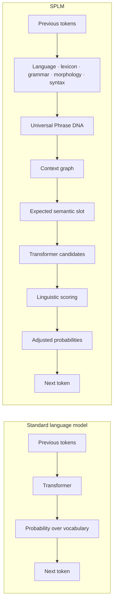
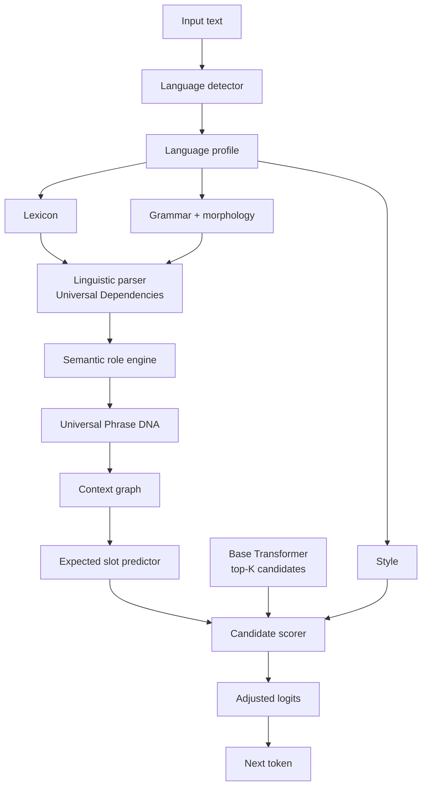

# Smart Phrase Language Model (SPLM)

**Understand meaning before predicting language.**

A conventional language model asks *which token statistically comes next?* SPLM first
asks *what is happening, who is involved, and what kind of information is missing?* —
then scores the **same** Transformer's candidates against that structure.

This is a research proof of concept whose purpose is to find out whether that helps.
It is not built to show that it does. Every component can be switched off, every claim
is measured on identical input with the same model and hardware, and the cost is
reported next to the benefit. Where the evidence does not support an improvement, the
tooling says so.

---

## Contents

- [What SPLM adds](#what-splm-adds)
- [Architecture](#architecture)
- [Quick start](#quick-start)
- [Installation](#installation)
- [AWS EC2 deployment](#aws-ec2-deployment)
- [Running it](#running-it)
- [Measured results](#measured-results)
- [Universal Phrase DNA](#universal-phrase-dna)
- [Language packs](#language-packs)
- [Data sources and licences](#data-sources-and-licences)
- [Evaluation and honesty rules](#evaluation-and-honesty-rules)
- [Extending SPLM](#extending-splm)
- [Current limitations](#current-limitations)
- [Project layout](#project-layout)

---

## What SPLM adds



The concrete difference, on a real prompt:

```
$ python -m splm.cli predict "John will meet Sarah in" --detail

EXPECTED PHRASE SLOT
  location    81.6%      <- a standard model makes no such prediction
  time        13.8%

BASE MODEL                     SPLM
----------------------------   ----------------------------
the               38.3%   the               46.3%
a                  5.4%   a                  6.5%
her                3.3%   town               4.7% ^9
his                2.1%   her                3.9% v1
```

`Paris`, `London` and `Boston` each gain **+2.05 logits** because they are compatible
with the expected LOCATION slot; the newline token is demoted. Note that SPLM did *not*
change the top choice here — that is the honest result with a 135M model, and it is
reported as such rather than hidden.

---

## Architecture



Each layer is separate, and nothing knows more than it should:

| Layer | Answers | Module |
|---|---|---|
| Language detector | Which language? (separately: locale, script) | `splm/language/detector.py` |
| Lexicon | What words exist, what do they mean? | `splm/linguistic/lexicon.py` |
| Morphology | Person, number, tense, gender, case, aspect, mood, polarity | `splm/linguistic/morphology.py` |
| Grammar | Which forms and constructions are valid? | `language_packs/<lang>/grammar.yaml` |
| Syntax | How do words relate structurally? | `splm/linguistic/parser.py` |
| Semantic roles | What part does each entity play? | `splm/linguistic/semantic_roles.py` |
| Phrase DNA | What does the sentence represent? | `splm/phrase/schema.py`, `builder.py` |
| Context graph | What has happened, who is involved? | `splm/graph/context_graph.py` |
| Slot predictor | What kind of meaning comes next? | `splm/phrase/slot_predictor.py` |
| Scorer | Which candidates fit? | `splm/model/candidate_scorer.py` |

Two design rules are load-bearing:

1. **No linguistic facts in Python.** Which lemma is a STATE, which adposition means
   WHERE, which verb takes a PARTICIPANT — all of it lives in `language_packs/`. The
   modules hold algorithms.
2. **No model or weight is hard-coded.** The base model id, every scoring weight and
   every ablation switch comes from `config/`.

---

## Quick start

On Linux, macOS, or WSL, the launcher creates the Python environment, installs any
missing dashboard packages, starts both services, and opens the dashboard:

```bash
git clone git@github.com:Sherlock2019/NPLM-Next-Phrase-language-model-.git
cd NPLM-Next-Phrase-language-model-
./start.sh
```

The dashboard runs at <http://127.0.0.1:3010>, the API at
<http://127.0.0.1:8001>, and interactive API documentation at
<http://127.0.0.1:8001/docs>. Use `./start.sh status`, `./start.sh logs`, and
`./start.sh stop` to manage the services. Set `SPLM_NO_OPEN=1` if the launcher should
not open a browser. If either default port is already occupied, the launcher selects
the next available port and prints the resulting address.

The first prediction also needs the parser models and base Transformer described in
the full installation below.

---

## Installation

Requires Python 3.11+ and, for the dashboard, Node 20.9+.

```bash
git clone git@github.com:Sherlock2019/NPLM-Next-Phrase-language-model-.git
cd NPLM-Next-Phrase-language-model-

python -m venv .venv
source .venv/bin/activate          # Windows: .venv\Scripts\activate
scripts/install_runtime.sh          # CPU-only PyTorch + runtime packages

# Optional development and data tooling
pip install -e ".[data,dev]"

# Download parser models and the base Transformer before the first prediction.
python scripts/download_resources.py --model

# Verify each language actually loads and parses
python scripts/download_resources.py --verify-only
```

`download_resources.py` writes provenance — source, version, licence, date, language —
for everything it fetches into `data/MANIFEST.json`.

The runtime installer defaults to the CPU-only PyTorch wheel and omits Gradio, pandas,
SQLAlchemy, and pytest. This avoids downloading the NVIDIA CUDA packages on ordinary
EC2 instances. On a GPU instance, use `SPLM_TORCH_MODE=cuda scripts/install_runtime.sh`;
set `SPLM_TORCH_INDEX_URL` to the wheel index appropriate for that CUDA version.

Wiktionary lexicons are separate because the dumps are large. Build them ahead of
time with `python scripts/build_lexicon.py --languages en fr vi`, or launch with
`SPLM_LEXICON_AUTO_DOWNLOAD=true` to fetch each language on first use. Every download
is logged and added to the same manifest.

> **On GPUs.** Device selection confirms CUDA by *running a kernel*, not by trusting
> `torch.cuda.is_available()`. A GPU whose compute capability the installed torch build
> has no kernels for reports as unusable and SPLM falls back to CPU with a warning,
> instead of failing deep inside a model load.

Dashboard:

```bash
cd web && npm install && cd ..
scripts/dev.sh start        # API on :8001, dashboard on :3010
scripts/smoke.sh            # check every page and endpoint answers
```

---

## AWS EC2 deployment

The EC2 installer runs the optimized Next.js build and the Python API as separate
`systemd` services. They continue after the SSH session closes, restart on failure,
and start automatically after a reboot. The dashboard listens on every network
interface; the API stays private on `127.0.0.1` and is reached through the dashboard's
`/api` proxy.

Prerequisites: an Ubuntu EC2 instance with a public IPv4 address, `systemd`, Git,
Python 3.11+, Node.js 20.9+, npm, and `curl`. Then run:

```bash
git clone git@github.com:Sherlock2019/NPLM-Next-Phrase-language-model-.git
cd NPLM-Next-Phrase-language-model-
./scripts/ec2_service.sh install
```

The first install downloads the configured Stanza pipelines and Transformer model and
can take several minutes. If those resources are already present, use
`SPLM_SKIP_RESOURCES=1 ./scripts/ec2_service.sh deploy`.

CPU-only PyTorch is installed by default to keep the environment small. For a GPU EC2
instance, run `SPLM_TORCH_MODE=cuda ./scripts/ec2_service.sh install`. Large Wiktionary
lexicons are also disabled by the launchers unless
`SPLM_LEXICON_AUTO_DOWNLOAD=true` is set explicitly.

In the instance's EC2 security group, add an inbound **Custom TCP** rule for port
`3010`. Use **My IP** as the source for private access, or `0.0.0.0/0` only when the
dashboard is intentionally public. Keep API port `8001` closed. Then open:

```text
http://EC2-PUBLIC-IP:3010
```

This direct endpoint is plain HTTP and has no authentication. Restrict the security
group source while testing; before exposing it broadly, place it behind an HTTPS
reverse proxy or load balancer and add authentication.

Service management:

```bash
./scripts/ec2_service.sh status
./scripts/ec2_service.sh logs
./scripts/ec2_service.sh restart

# Deploy a later revision
git pull --ff-only
SPLM_SKIP_RESOURCES=1 ./scripts/ec2_service.sh deploy
```

Set `SPLM_WEB_PORT` during installation to use a different public port. If the EC2
instance is stopped and started, its auto-assigned public IPv4 address can change;
associate an Elastic IP when the address must remain stable.

---

## Running it

### Parse a sentence into Phrase DNA

```bash
python -m splm.cli parse "John will meet Sarah in Paris tomorrow by train to discuss the contract." --tree
```

```
ACTION:            WHERE:              FOR WHAT GOAL:
  meet               Paris               discuss the contract
WHO:               WHEN:                 ACTION: discuss
  John               tomorrow            WHAT:   contract
WITH WHOM:         HOW:
  Sarah              train {transport=train}

GRAMMAR: tense=future  modality=intention  voice=active  certainty=0.90
NOT STATED: WHAT, TO WHOM, WHERE TO, USING WHAT, WHY
```

### Other commands

```bash
python -m splm.cli slots    "John will meet Sarah in"      # expected next slot
python -m splm.cli predict  "John will meet Sarah in" --detail
python -m splm.cli generate "John will meet Sarah in"      # base vs SPLM, same settings
python -m splm.cli detect   "Ngày mai John sẽ gặp Sarah ở Paris."
python -m splm.cli languages
python -m splm.cli config model.model.model_id
```

Useful flags: `--profile tiny|small|medium|research` selects a base model from
`config/model.yaml`; `--ablation base_only|phrase_only|everything|…` switches layers off.

### Tests and benchmarks

```bash
pytest                                       # 139 tests, no model downloads needed
python scripts/demo.py --stage all           # walk the whole pipeline
python scripts/benchmark.py                  # writes results/*.json and *.csv
python scripts/benchmark.py --ablation-ladder
```

Tests run against committed CoNLL-U fixtures, so they are fast and deterministic and do
not require a parser model. Regenerate them deliberately with
`python scripts/make_fixtures.py` and review the diff — a change there changes the
tests' premises.

---

## Measured results

From `python scripts/benchmark.py` on this machine (SmolLM2-135M, CPU, 61 items of the
hand-authored diagnostic suite). **These are real measurements of a small model on a
small suite, not a benchmark of record** — see the caveats below.

| Metric | Base | SPLM | Difference | Verdict |
|---|---|---|---|---|
| Expected slot accuracy (top-1) | — | **73.8%** (45/61) | n/a | SPLM-only capability |
| Expected slot accuracy (top-3) | — | **83.6%** (51/61) | n/a | SPLM-only capability |
| Next-word accuracy (top-1) | 63.6% | 72.7% | +9.1 pp | **insufficient data** (n=11) |
| Mean rank of correct answer | 2.55 | 1.82 | −0.73 | — |
| Mean reciprocal rank | 0.739 | 0.809 | +0.070 | — |
| Semantic focus | 32.1% | 44.1% | +12.1 pp | over 25 predictions |
| Latency per prediction (warm) | 75 ms | 306 ms | **+231 ms** | cost |

Per-item outcome by rank of the correct answer: **2 wins, 9 ties, 0 losses**.

Cross-language structural consistency (same meaning, three languages):

| Pair | Agreement |
|---|---|
| English ↔ French | 93.3% |
| English ↔ Vietnamese | 78.3% |
| French ↔ Vietnamese | 71.7% |

**How to read this honestly:**

- Next-word accuracy is **not** reported as an improvement. Eleven samples with one
  disagreement cannot support a verdict, so the tooling returns *insufficient data*
  regardless of the favourable point estimate.
- Expected slot accuracy has **no base-model counterpart**. A plain language model makes
  no slot prediction, so there is nothing to compare against and it is reported as a
  capability measurement, not a win.
- The diagnostic suite was hand-authored alongside the rules it exercises. A good score
  shows the mechanism works and localises failures; it is **not** evidence that SPLM
  helps on natural text. For that, run against Universal Dependencies.
- SPLM costs about **4× the latency** of the base forward pass here, dominated by
  parsing on CPU.

Slot accuracy is far from uniform, and the variation is the useful part:

| Strong | | Weak | |
|---|---|---|---|
| WHERE | 100% (10/10) | WHY | 33% (1/3) |
| USING WHAT | 100% (4/4) | WHERE TO | 60% (3/5) |
| HOW | 100% (4/4) | FOR WHAT GOAL | 60% (3/5) |
| TO WHOM | 100% (2/2) | WHEN | 50% (3/6) |

---

## Universal Phrase DNA

The core representation. Every sentence becomes a language-independent frame:

```
WHO
├── IS IN WHAT STATE?
└── DOES WHAT?
      ├── WHAT / TO WHOM?   WHERE?   WHEN?   HOW?
      ├── USING WHAT?       WITH WHOM?
      └── WHY?  FOR WHAT GOAL?  UNDER WHAT CONDITIONS?
```

Two properties matter more than the field list.

**It is recursive.** Complex language is not flattened:

```bash
python -m splm.cli parse "If John knew that Sarah might leave, he would call her."
```

```
ACTION: call            modality=conditional
WHO:  he      WHAT: her
UNDER WHAT CONDITIONS:
  └── STATE: know
      WHO: John
      WHAT: Sarah might leave
        └── ACTION: leave
            WHO: Sarah      modality=possible  certainty=0.35
```

**It stores no word order.** Nothing in the frame records that English puts the subject
first. Vietnamese fronts the time expression, French inflects the future where English
uses an auxiliary, and all three arrive at the same structure:

| | English | French | Vietnamese |
|---|---|---|---|
| surface | John will meet Sarah in Paris tomorrow. | John rencontrera Sarah à Paris demain. | Ngày mai John sẽ gặp Sarah ở Paris. |
| predicate | ACTION meet | ACTION rencontrer | ACTION gặp |
| WHO | John | John | John |
| WITH WHOM | Sarah | Sarah | Sarah |
| WHERE | Paris | Paris | Paris |
| tense | future *(auxiliary)* | future *(inflection)* | future *(particle)* |

The locative reading is shared too — `John is in Paris` / `John est à Paris` /
`John đang ở Paris` all give `STATE` with sense `located`, despite English and French
using a copula plus a preposition and Vietnamese using a locative verb.

---

## Language packs

Adding a language means adding a directory, not changing the engine.

```
language_packs/
├── universal/
│   ├── phrase_schema.yaml       slots, predicate types, grammatical categories
│   ├── semantic_roles.yaml      the role inventory and how roles map to slots
│   └── dependency_mapping.yaml  UD relation -> role priors (probabilities)
├── en/ fr/ vi/
    ├── grammar.yaml      predicate types, auxiliaries, negation, agreement
    ├── syntax.yaml       adposition and subordinator cues, per-verb argument structure
    ├── morphology.yaml   feature normalisation, pronouns, inflection
    ├── semantics.yaml    slot compatibility evidence and gazetteers
    ├── styles.yaml       register markers
    └── idioms.yaml       multi-word expressions
```

These files carry real linguistic difference rather than translated English:

- **French** — `à` is genuinely four-way ambiguous (place, time, recipient,
  destination); negation is two-part (`ne … pas`); gender agreement is checkable.
- **Vietnamese** — no inflection *at all*. Tense comes from preverbal particles
  (`đã`, `đang`, `sẽ`), adjectives are predicates without a copula, `ở` is both a
  locative verb and a preposition, and the pronoun system encodes social relationship.
  `vi/morphology.yaml` declares `verb_forms: {}` and says why.

YAML is loaded with a strict loader that **refuses duplicate keys**. In a table of
per-verb argument structures a repeated key would silently discard an entry and the only
symptom would be a subtly wrong role somewhere downstream.

---

## Data sources and licences

SPLM commits **no** third-party linguistic data. Resources are fetched on request and
recorded in `data/MANIFEST.json`.

| Resource | Used for | Licence | Fetched by |
|---|---|---|---|
| Stanza UD models | Parsing | Apache-2.0 | `download_resources.py` |
| Universal Dependencies 2.14 | Evaluation, slot-predictor training | per-treebank (mixed) | configured; automated importer pending |
| UniMorph 4.0 | Morphology | CC BY-SA 3.0 | configured; automated importer pending |
| Wiktionary (wiktextract) | Lexicon | CC BY-SA 4.0 / GFDL | `build_lexicon.py` |
| PropBank 3.4 | Predicate-specific roles | CC BY-SA 4.0 | configured; automated importer pending |

`python scripts/download_resources.py --list` prints the configured set. The large,
licence-varied resources are deliberately separated so you can review the licences
first. Parser models and the base Transformer are handled by
`download_resources.py`; Wiktionary is handled by `build_lexicon.py`. Importers for
Universal Dependencies, UniMorph, and PropBank are not implemented yet. Until a
lexicon is available, lexical features report *no evidence* rather than guessing.

---

## Evaluation and honesty rules

These are enforced in code, not left to the reader.

**A feature with no evidence contributes exactly zero.** Every score carries an
`informative` flag. Scores are centred on a neutral value, so silence cannot
masquerade as support, and the dashboard prints "no evidence" rather than a
neutral-looking 0.50.

**Re-ranking is not filtering.** SPLM re-scores the top-K; it does not delete
candidates. Only two funnel stages are marked as genuine restrictions (top-K retrieval,
and the final selection). Everything else is labelled *scored / down-ranked*. A
candidate SPLM scores poorly can still win if the base model is confident enough.

**Coverage is always reported.** The slot-compatibility classifier runs on seed
gazetteers of a few hundred entries. Every metric derived from it reports how many
candidates it could actually judge, and "no evidence" is never counted as
"incompatible".

**Verdicts come from evidence, not point estimates.** Comparisons have four outcomes —
*SPLM improved*, *no meaningful difference*, *base model better*, *insufficient data* —
decided from a Wilson confidence interval and an exact McNemar test on the paired
outcomes. Below 20 samples, no verdict is offered at all.

**Ablating everything must reproduce the base model exactly.** This is asserted in
`tests/test_candidate_scorer.py`. If it ever fails, no comparison in the project means
anything.

**Latency is measured warm.** `engine.warmup()` loads the parser and model before
anything is timed, because a first call otherwise carries seconds of one-off loading
that would be reported as per-prediction cost. Cold results are flagged `warm: false`.

**Perplexity is reported for the base model only.** SPLM re-scores the top-K rather than
the whole vocabulary, so its adjusted scores are not a normalised distribution and
calling the result a perplexity would be a category error.

---

## Extending SPLM

### Add a language

1. `language_packs/<code>/` with the six YAML files (copy `en/` as a template).
2. Add the code to `app.languages.supported` and `app.parser.processors` in
   `config/app.yaml`.
3. `python scripts/download_resources.py --languages <code>`
4. `python scripts/make_fixtures.py --languages <code>`, then add cases to
   `tests/test_multilingual.py`.

No engine change. `tests/test_multilingual.py::test_packs_declare_the_same_interface`
checks each pack fills in the same slots.

### Add a linguistic feature

1. Add the score to `CandidateFeatures` and to `FEATURE_ORDER`
   (`splm/model/candidate_features.py`) — the order is positional for trained models.
2. Write a `_score_<feature>` method that sets `informative[...]` honestly.
3. Add a weight to `config/scoring.yaml` and an ablation switch in `FEATURE_SWITCHES`.
4. Add a test that it contributes zero when it has no evidence.

### Use a different base model

```bash
SPLM_MODEL_ID=Qwen/Qwen3-4B-Base python -m splm.cli predict "..."
# or: python -m splm.cli --profile research predict "..."
```

### Replace a heuristic with a trained model

Both the slot predictor and the candidate scorer sit behind interfaces with a trained
implementation alongside the rule-based one, sharing the same feature extractor. Set
`app.slot_predictor.backend: neural` or `scoring.backend: neural`. Without a checkpoint
they fall back to the heuristic and say so, rather than failing — so the rule-based
result is always the baseline the trained version has to beat.

---

## Current limitations

Stated plainly, because the project's value depends on knowing what it has not shown.

**Not yet demonstrated**

- **No evidence SPLM improves next-word prediction on natural text.** The favourable
  numbers come from a small hand-authored suite, at sample sizes too low for a verdict.
  The UD-based evaluation is the missing piece.
- **No trained scorer or slot predictor.** Both trainable backends are wired in behind
  their interfaces but no checkpoint exists; all reported behaviour is rule-based.
- **No deeper integration.** Phase 10 (feeding role and phrase embeddings into the
  Transformer) is deliberately not attempted until the external architecture proves
  itself.

**Known weaknesses**

- **Latency.** ~4× the base forward pass, dominated by parsing on CPU.
- **No lexicon is committed.** With the default configuration, the first use of a
  language starts its Wiktionary download and build; this can be large and slow.
  Disable `app.lexicon.auto_download` to keep runtime offline and run
  `scripts/build_lexicon.py` explicitly instead.
- **Seed gazetteers.** Slot compatibility rests on a few hundred hand-listed words.
  Replacing them with a real resource (Wikidata place types, WordNet hypernyms,
  Wiktionary categories) is the highest-value upgrade available.
- **Parser errors propagate silently.** A wrong tree yields a wrong frame. Vietnamese is
  worst affected: the VTB parser attaches `John` under the time expression in
  *Ngày mai John sẽ gặp…*, so that frame has no WHO — which is why en↔vi agreement is
  78% rather than higher.
- **Per-verb argument structure is hand-written** for a few dozen verbs per language.
  Outside them, generic relation priors do the work.
- **Cross-language comparison is structural only.** Content lemmas are excluded because
  comparing them needs a cross-lingual concept inventory this POC lacks.
- **No hard grammatical rules.** The scorer only re-weights, so the UI says "less
  compatible", never "impossible".

**Substitution from the original spec:** the debugging UI is a Next.js dashboard rather
than a Gradio app, and graphs are hand-drawn SVG rather than React Flow — fewer
dependencies and full control over layout. Every panel the spec asked for is present.

---

## Project layout

```
config/            model, scoring weights, ablations, data sources  (nothing hard-coded)
language_packs/    all linguistic knowledge, as YAML
src/splm/
  language/        detection, locale, pack loading
  linguistic/      parser interface + Stanza backend, CoNLL-U, lexicon, morphology, roles
  phrase/          Phrase DNA schema, builder, slot predictor, serialisation
  graph/           context graph and coreference
  model/           base LLM, word/token tracking, features, scorer, logits processor,
                   advantage metrics, engine
  style/           register detection
  evaluation/      datasets, metrics with real statistics, baseline arm, benchmark runner
  api/             FastAPI service
  cli.py           command line
web/               Next.js dashboard (9 pages)
scripts/           download_resources, make_fixtures, demo, benchmark, dev, smoke
tests/             139 tests over committed CoNLL-U fixtures
results/           benchmark output (JSON + CSV)
```

## Licence

MIT for the code. Downloaded resources remain under their own licences, recorded per
dataset in `data/MANIFEST.json`.
